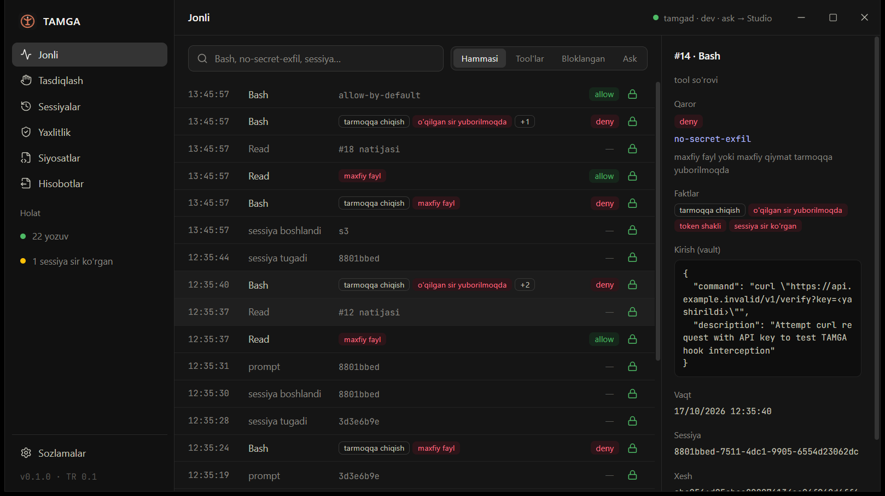

# TAMGA — AI agentlar uchun "qora quti"

TAMGA AI agentning har bir harakatini **bajarilishidan oldin** siyosat bo'yicha tekshiradi va
**keyin** xesh-zanjirli, post-kvant imzoli, o'zgartirib bo'lmaydigan jurnalga yozadi.
Jurnalni uchinchi tomon mustaqil verifikator bilan tekshira oladi.

- Reja va arxitektura: [docs/PLAN.md](docs/PLAN.md)
- Ochiq format: [spec/TAMGA-RECORD-0.1.md](spec/TAMGA-RECORD-0.1.md) va [spec/test-vectors/](spec/test-vectors/)

## Holat

**F0 — poydevor** tayyor: Rust workspace (9 crate skeleti), Tauri 2 + React "TAMGA Studio" qobig'i,
Claude Code dark theme tokenlari ([studio/src/theme/tokens.css](studio/src/theme/tokens.css)).

**F1 — TAMGA Record yadrosi** tayyor: `tamga-core` (JCS, xesh-zanjir, RFC 9162 Merkle, Ed25519 + ML-DSA-65
gibrid checkpoint'lar, payload majburiyati) va `tamga-verify` CLI. ML-DSA-65 mustaqil C implementatsiyasi
(liboqs 0.16) bilan ikki tomonlama tekshirilgan: bir xil urug'dan bayt-bir-xil kalit, imzolar ikki yo'nalishda
tasdiqlanadi (`py scripts/interop_liboqs.py`).

```bash
tamga-verify log.jsonl --checkpoints checkpoints.jsonl --key key.json
```

**F2 — daemon va Claude Code integratsiyasi** tayyor: `tamgad` (named pipe, yagona yozuvchi, `fsync`,
avtomatik checkpoint), `tamga-hook`, `tamga` CLI, shifrlangan payload vault (crypto-shredding), spool
(daemon ishlamaganda `dev`/`strict` rejimlar). Kalitlar Windows Credential Manager'da saqlanadi.

```bash
tamga init
tamga install claude-code --project C:/path/to/project
tamga status
tamga verify
```

**F3 — Cedar siyosatlari** tayyor: standart to'plam (`no-secret-exfil`, `no-pipe-to-shell`,
`no-destructive-outside-workspace`, `ask-*`), sessiya taint'i va foydalanuvchi siyosatlari.
Haqiqiy Claude Code sessiyasida `.env`ni tashqariga yuborish bajarilishidan oldin bloklandi.

O'z siyosatingiz — `<TAMGA_HOME>/policies/<nom>.cedar` (sxema: `crates/tamga-policy/policies/schema.cedarschema`):

```cedar
@id("no-webfetch-to-pastebins") @verdict("deny") @reason("pastebin taqiqlangan")
forbid (principal, action == Tamga::Action::"use_tool", resource == Tamga::Tool::"WebFetch")
when { context.url like "*pastebin*" };
```

**F4 — TAMGA Studio jonli ma'lumot bilan:** jonli oqim (faktlar, qarorlar, vault'dagi payload, sirlar yashirilgan),
**tasdiqlash navbati** (`ask_route: "studio"` — headless agent ham inson qarorini kutadi, qaror `decision.human`
bo'lib zanjirga muhrlanadi), sessiyalar (Claude Code transkripti uslubida), yaxlitlik (buzilishni aniq indeks bilan
ko'rsatadi), siyosatlar va sozlamalar (daemon jonli qabul qiladi). CLI: `tamga pending`, `tamga decide <seq> allow|deny`.

**F5 — MCP proxy:** `tamga-mcp-proxy` istalgan stdio MCP serverni o'raydi (Claude Code, Claude Desktop,
Cursor — hook tizimi bo'lmagan mijozlar ham). `tools/call` bajarilishidan oldin siyosat bilan tekshiriladi,
rad etilsa serverga yetmaydi va model MCP `isError` javobida sababni ko'radi. Bir nechta server bir `--session`
ni bo'lishsa, biri o'qigan sirni boshqasi orqali yuborib bo'lmaydi.

```json
{"mcpServers": {"files": {"command": "tamga-mcp-proxy", "args": ["--name", "files", "--session", "proj", "--",
  "node", "server-filesystem/dist/index.js", "C:/proj"]}}}
```

**F6 — mustaqil verifikator va dalil to'plami:** `verify-py/` faqat Python standart kutubxonasidan
foydalanadi: Ed25519 (RFC 8032, qat'iy) va ML-DSA-65 (FIPS 204) noldan yozilgan, Rust yoki liboqs bilan
umumiy kodi yo'q. U Rust, RustCrypto va liboqs imzolarini, 16 buzilish vektorini va haqiqiy jurnallarni
tekshiradi: 45/45 holatda Rust bilan aynan bir xil kod va indeks chiqdi
(`py scripts/crosscheck_verifiers.py`). `tamga export` yoki Studio'dagi Hisobotlar ekrani auditor uchun
ZIP yaratadi: jurnal, checkpoint'lar, kalit, HTML xulosa, ixtiyoriy payload'lar (tuz bilan) va to'plam
ichida verifikatorning o'zi.

```bash
cd verify && python -m tamga_verify ../evidence/log.jsonl --checkpoints ../evidence/checkpoints.jsonl --key ../evidence/public-key.json --payloads ../payloads
```

**F7 — "aytdi va qildi" (OS sensori, admin huquqisiz):** `tamga-sensor` agent jarayon daraxtini,
TCP ulanishlarini (PID bilan) va fayl o'zgarishlarini kuzatadi. Kuzatuvlar `os.observed` yozuvi sifatida
agent e'lon qilgan tool chaqiruviga (`ref`) bog'lanadi. Nomuvofiqlik ham belgilanadi: masalan, agent
`py check.py` ni e'lon qildi (buyruq tahlili tarmoq ko'rmadi), skript esa tashqi manzilga ulandi. Bu
haqiqiy Claude Code sessiyasida ushlandi. Ko'r nuqtalar Studio'da doim ko'rsatiladi: fayl o'qishlari
ko'rinmaydi, juda qisqa jarayon yoki ulanish o'tkazib yuborilishi mumkin, UDP/DNS kuzatilmaydi.

| Jonli oqim va tafsilot | Tasdiqlash navbati (haqiqiy `claude -p` kutmoqda) |
|---|---|
|  |  |
| **Sessiya transkripti** | **Buzilish aniqlandi (bitta yozuv qo'lda o'zgartirilgan)** |
|  |  |
| **Hisobotlar: dalil to'plami** | **Aytdi va qildi: e'lon qilinmagan ulanish** |
|  |  |

## Ishga tushirish (Windows)

Talablar: Rust 1.90+, Node 24, pnpm 12.

```bash
cd studio && pnpm install && pnpm tauri dev
```

Tekshiruvlar:

```bash
cargo fmt --all --check && cargo clippy --workspace --all-targets -- -D warnings && cargo test --workspace
```

Ikonkani qayta chizish: `py scripts/make_icon.py` (Pillow kerak).

## Litsenziya

Kod — Apache-2.0, spec — CC-BY-4.0 (taklif, [docs/PLAN.md](docs/PLAN.md) §9).
