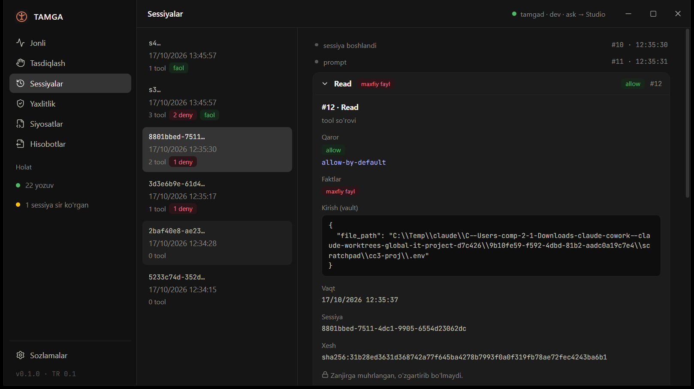
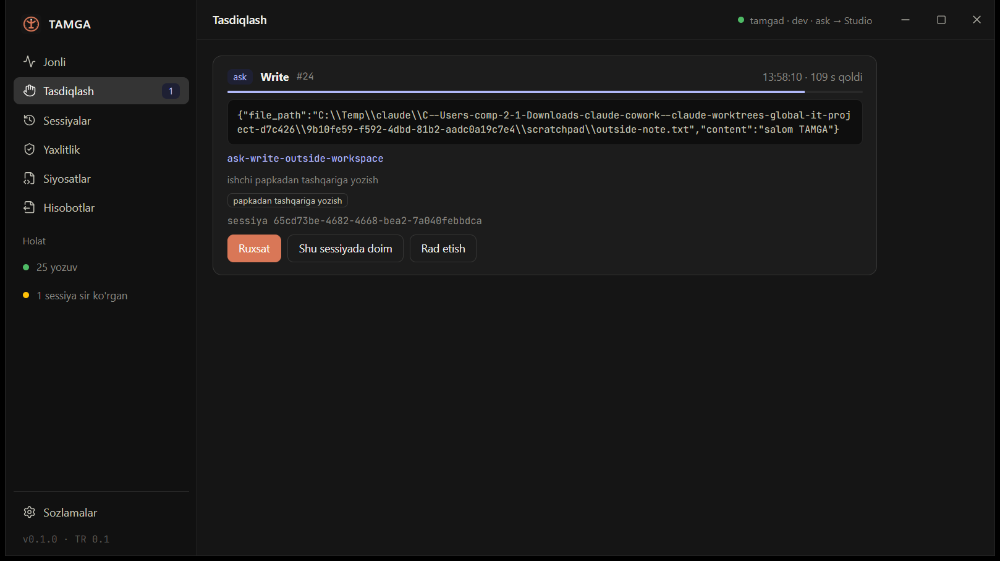
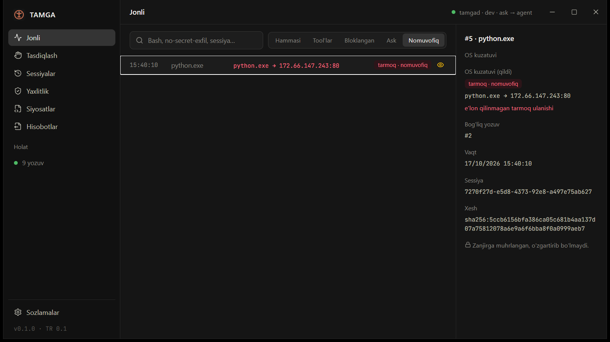
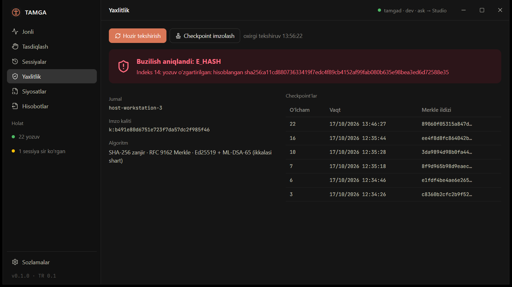
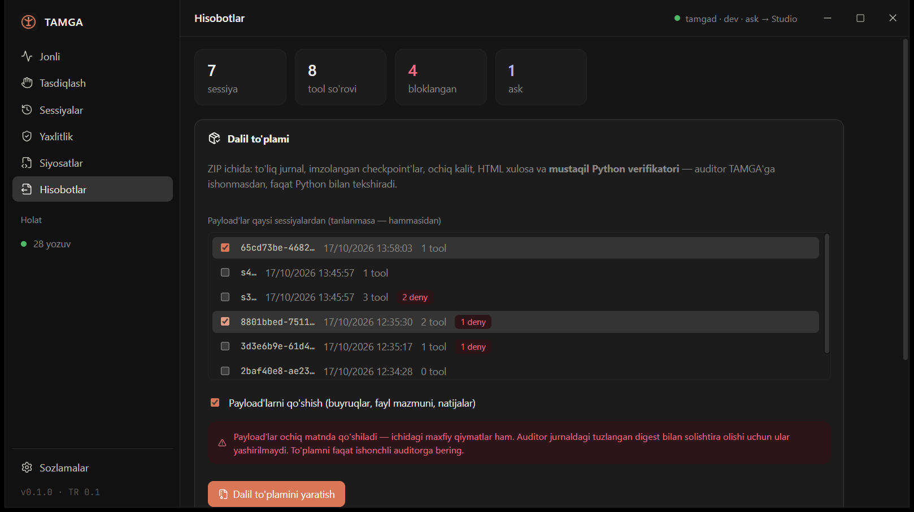
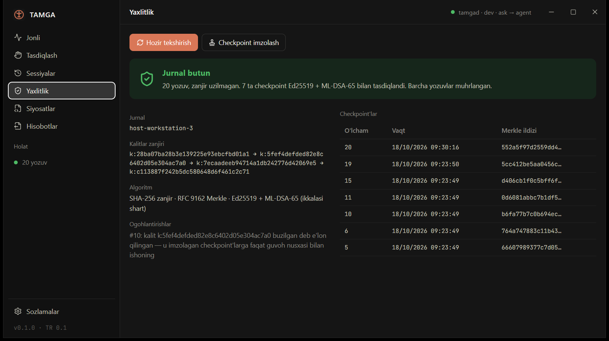

# TAMGA — AI agentlar uchun «qora quti»

**TAMGA** AI agent (Claude Code, MCP mijozlari) qiladigan har bir amalni **bajarilishidan oldin**
siyosat bilan tekshiradi, uni xesh-zanjirli va **post-kvant imzoli** jurnalga yozadi, agent
*aytgani*ni OS *ko'rgani* bilan solishtiradi. Jurnalni uchinchi tomon TAMGA'siz, faqat Python
standart kutubxonasi bilan tekshira oladi.

> *Tamg'a* — qadimgi turkiy muhr: kim, qachon va nima qilganini tasdiqlaydigan belgi.



## Nima uchun

AI agentlar endi buyruq ishga tushiradi, fayl yozadi, tarmoqqa chiqadi. Hodisadan keyin «agent
aslida nima qildi?» degan savolga javob odatda yo'q: transkript agentning *o'z* hikoyasi, uni
tahrirlash mumkin, OS darajasida nima bo'lgani esa umuman yozilmaydi. TAMGA uchta narsani birlashtiradi:

| | |
|---|---|
| **To'xtatadi** | Cedar siyosatlari: `.env` ni tashqariga yuborish, internetdan skriptni shell'ga uzatish, ishchi papkadan tashqarida o'chirish — bajarilishidan **oldin** bloklanadi. Sessiya «taint»i ikki bosqichli sizdirishni ham ushlaydi. |
| **Isbotlaydi** | Har yozuv RFC 8785 JCS + SHA-256 zanjiri, RFC 9162 Merkle daraxti; checkpoint'larda **Ed25519 va ML-DSA-65** (FIPS 204) gibrid imzosi. Bitta bayt o'zgarsa — aniq indeks bilan topiladi. |
| **Solishtiradi** | Admin huquqisiz OS sensori agent jarayon daraxtini, TCP ulanishlarini va fayl o'zgarishlarini kuzatadi: «aytdi va qildi» farqi (masalan, e'lon qilinmagan tarmoq ulanishi) alohida belgilanadi. |

## O'rnatish (Windows 10/11)

1. `TAMGA Studio_0.1.0_x64-setup.exe` ni ishga tushiring (5 MB, administrator huquqi **kerak emas** —
   `%LOCALAPPDATA%\TAMGA Studio` ga o'rnatiladi). Jim o'rnatish: `setup.exe /S`.
2. TAMGA Studio → **Sozlamalar → Claude Code integratsiyasi → «Claude Code'ga ulash»**.
   Hook'lar `~/.claude/settings.json` ga qo'shiladi; boshqa sozlamalaringiz saqlanadi, avval
   `settings.json.tamga-backup` zaxirasi yoziladi. Yangi ochilgan Claude Code sessiyalari yozila boshlaydi.

O'rnatuvchi Studio bilan birga 5 ta yordamchi dasturni qo'yadi:

| Fayl | Vazifa |
|---|---|
| `tamgad.exe` | daemon: yagona yozuvchi, siyosat, vault, checkpoint, OS sensori (named pipe, faqat joriy foydalanuvchi) |
| `tamga-hook.exe` | Claude Code hook'i (p99 ≈ 11–13 ms); daemon ishlamasa uni o'zi ishga tushiradi |
| `tamga-mcp-proxy.exe` | istalgan stdio MCP serverni siyosat bilan o'raydi |
| `tamga.exe` | CLI: `init`, `status`, `stop`, `verify`, `pending`, `decide`, `export`, `shred` … |
| `tamga-verify.exe` | mustaqil verifikator (faqat ochiq kalit kerak) |

**Ma'lumotlar qayerda:** jurnal, shifrlangan payload vault va sozlamalar — `%LOCALAPPDATA%\tamga`;
imzo va vault kalitlari — Windows Credential Manager. **O'chirish** (Sozlamalar → Ilovalar yoki
`uninstall.exe /S`) daemon'ni oxirgi checkpoint bilan to'xtatadi va Claude Code hook'larini olib
tashlaydi. Jurnal va kalitlar **qoladi**: bu dalil, uni o'zingiz saqlaysiz yoki o'chirasiz.

## 10 daqiqalik demo

```powershell
powershell -ExecutionPolicy Bypass -File demo\run-demo.ps1 -Studio
```

Haqiqiy Claude Code sessiyalarida: sir sizdirish bloklanadi (bir va ikki bosqichli), skriptning
aytilmagan ulanishi ushlanadi, xavfli amal inson tasdig'ini kutadi, so'ng dalil to'plami eksport
qilinadi va jurnalni buzishning uch usuli ham aniq joyi bilan topiladi. Hammasi alohida qum
qutisida — sizning sozlamalaringizga tegilmaydi. Batafsil: [docs/DEMO.md](docs/DEMO.md).

| Tasdiqlash navbati (haqiqiy `claude -p` kutmoqda) | Aytdi va qildi: e'lon qilinmagan ulanish |
|---|---|
|  |  |
| **Buzilish aniqlandi (bitta yozuv o'zgartirilgan)** | **Hisobotlar: auditor uchun dalil to'plami** |
|  |  |

## Qanday ishlaydi

```text
 Claude Code ── hook ──▶ tamga-hook ─────┐                        ┌──▶ jurnal (JSONL, xesh-zanjir)
 MCP mijoz ─── stdio ─▶ tamga-mcp-proxy ─┼─ named pipe ─▶ tamgad ─┼──▶ vault (payload'lar, XChaCha20-Poly1305)
 TAMGA Studio / tamga CLI ───────────────┘   faktlar → Cedar      ├──▶ checkpoint (Merkle + Ed25519 + ML-DSA-65)
                                             deny · ask · allow   └──▶ OS sensori (jarayon, TCP, fayl) → os.observed
```

1. **Hook** Claude Code'dan `PreToolUse`/`PostToolUse`/sessiya hodisalarini oladi va daemon'ga yuboradi.
   TAMGA hech qachon `allow` qaytarmaydi — faqat `deny` yoki `ask`; Claude Code'ning o'z ruxsat tizimi ishlayveradi.
2. **Faktlar tahlilchisi** buyruqni tushunadi: `reads_secret_file`, `network_egress`, `pipes_to_shell`,
   `writes_outside_workspace`, `sends_tainted_secret` … Cedar siyosati shu faktlar bo'yicha qaror chiqaradi
   (`deny` > `ask` > `allow`).
3. **ask** — agent oynasida yoki Studio'ning tasdiqlash navbatida (headless agent ham kutadi);
   inson qarori `decision.human` yozuvi bo'lib zanjirga muhrlanadi.
4. **Jurnal**: yozuvda payload'ning o'zi emas, faqat xeshi; matn sessiya kaliti bilan shifrlangan vault'da.
   `tamga shred <sessiya>` kalitni o'chiradi — matn unutiladi, jurnal esa tekshirilaveradi (GDPR uchun).
5. **OS sensori** hook bergan PID'dan agent ildizini topadi, 200 ms da jarayonlar va TCP jadvalini,
   maxfiy papkalardagi fayl o'zgarishlarini kuzatadi va har kuzatuvni tool chaqiruviga (`ref`) bog'laydi.

### Siyosatlar

Standart to'plam: `no-secret-exfil`, `no-pipe-to-shell`, `no-destructive-outside-workspace` (deny),
`ask-egress-after-secret-read`, `ask-force-push`, `ask-write-outside-workspace`, `ask-system-change` (ask).
O'zingiznikini `%LOCALAPPDATA%\tamga\policies\<nom>.cedar` ga qo'ying (sxema:
[schema.cedarschema](crates/tamga-policy/policies/schema.cedarschema)), daemon jonli qabul qiladi:

```cedar
@id("no-webfetch-to-pastebins") @verdict("deny") @reason("pastebin taqiqlangan")
forbid (principal, action == Tamga::Action::"use_tool", resource == Tamga::Tool::"WebFetch")
when { context.url like "*pastebin*" };
```

### MCP serverlar

Hook tizimi bo'lmagan mijozlar (Claude Desktop, Cursor) uchun: serverni `tamga-mcp-proxy` bilan o'rang.
Bloklangan `tools/call` serverga yetmaydi, model `isError` javobida sababni ko'radi. Bir nechta server
bitta `--session` ni bo'lishsa, biri o'qigan sirni boshqasi orqali yuborib bo'lmaydi.

```json
{"mcpServers": {"files": {"command": "tamga-mcp-proxy",
  "args": ["--name", "files", "--session", "proj", "--", "node", "server-filesystem/dist/index.js", "C:/proj"]}}}
```

## Mustaqil tekshirish

Jurnal formati ochiq: [spec/TAMGA-RECORD-0.1.md](spec/TAMGA-RECORD-0.1.md) va
[spec/test-vectors/](spec/test-vectors/) (JCS, zanjir, Merkle, checkpoint, 16 buzilish vektori, liboqs interop).

```powershell
tamga export --out dalil.zip            # yoki Studio → Hisobotlar
cd dalil\verify
python -m tamga_verify ..\evidence\log.jsonl --checkpoints ..\evidence\checkpoints.jsonl --key ..\evidence\public-key.json
```

[`verify-py/`](verify-py/) — faqat Python standart kutubxonasi: Ed25519 (RFC 8032, qat'iy) va ML-DSA-65
(FIPS 204) noldan yozilgan, Rust yoki liboqs bilan umumiy kodi yo'q. 45 ta holatda (Rust, RustCrypto,
liboqs imzolari, buzilish vektorlari, haqiqiy jurnallar) Rust verifikatori bilan aynan bir xil kod va
indeks beradi (`py scripts/crosscheck_verifiers.py`). Kalit ishonchi auditorga operatordan alohida
kanal orqali beriladi (spec §10).

Mustaqil xavfsizlik auditi uchun: [docs/AUDIT-GUIDE.md](docs/AUDIT-GUIDE.md) — AI yoki inson auditor
uchun da'volar ro'yxati (C1–C14), tahdid modeli, muallif topgan ochiq zaif nuqtalar (K1–K6), bosqichma-bosqich
tekshiruv va hisobot shakli.

## Imzo kalitlari: almashtirish va zaxira

Auditor faqat **langar** kalitni (`public-key.json`, jurnalning birinchi kaliti) operatordan oladi.
Kalit almashtirilganda jurnalga `key.rotate` yozuvi tushadi, uni eski kalit checkpoint bilan imzolaydi,
shundan keyin faqat yangi kalit qabul qilinadi (spec §7.5). Uchala verifikator zanjirni langardan o'zi tekshiradi.

```powershell
tamga key show                              # langar, almashtirishlar tarixi, faol kalit
tamga key rotate                            # rejali almashtirish (Studio → Sozlamalar → «Kalitni almashtirish»)
tamga key rotate --reason compromise        # kalit sizib chiqqan bo'lsa: verifikatorlar ogohlantiradi
tamga key backup --out D:\tamga.tamgakey    # imzo + vault kalitlari, parol bilan (Argon2id 64 MiB + XChaCha20-Poly1305)
tamga stop; tamga key restore D:\tamga.tamgakey   # yangi kompyuterda (jurnal fayllarini alohida ko'chiring)
```

Almashtirish yiqilishga chidamli: yangi kalit avval alohida joyda saqlanadi va faqat eski kalit
checkpoint'i yozilgandan keyin asosiyga aylanadi. Daemon ishga tushganda yarim qolgan almashtirishni
yakunlaydi yoki bekor qiladi. Ombordagi kalit jurnal kutgan kalitga mos kelmasa, imzolashdan bosh tortadi.



## Kod imzosi

`scripts/build-installer.ps1` sertifikat berilsa 5 ta sidecar'ni, Studio'ni, `uninstall.exe` ni va
o'rnatuvchining o'zini Authenticode bilan imzolaydi, RFC 3161 vaqt tamg'asi qo'yadi va `SHA256SUMS.txt`
yozadi. Sertifikat [scripts/sign.ps1](scripts/sign.ps1) orqali uch yo'ldan biri bilan beriladi:

| Usul | O'zgaruvchilar |
|---|---|
| Windows sertifikat ombori yoki USB token (OV/EV) | `TAMGA_SIGN_THUMBPRINT` |
| `.pfx` fayl | `TAMGA_SIGN_PFX`, `TAMGA_SIGN_PFX_PASSWORD` |
| Azure Trusted Signing | `TAMGA_SIGN_AZURE_DLIB`, `TAMGA_SIGN_AZURE_METADATA` |

Reliz yig'ishda `TAMGA_SIGN_REQUIRED=1` qo'ying: sertifikat bo'lmasa yig'ish to'xtaydi. Sertifikatning
o'zi (CA'dan sotib olinadi yoki Azure Trusted Signing obunasi) repo'da yo'q. U bo'lmaguncha o'rnatuvchi
imzosiz va SmartScreen «noma'lum nashriyotchi» deb ogohlantiradi.

## Xavfsizlik modeli va halol chegaralar

TAMGA **nimani kafolatlaydi:** yozilgan har yozuvni keyin o'zgartirish, o'chirish, qayta tartiblash yoki
oxirgi checkpoint'gacha kesish sezilmasdan qolmaydi; maxfiy payload matni diskda ochiq yotmaydi;
siyosat bloklagan buyruq bajarilmaydi.

**Nimani kafolatlamaydi** (ataylab yozib qo'yilgan):

- Kompyuterda administrator bo'lgan tajovuzkor daemon'ni to'xtatib, **keyingi** yozuvlarni yozdirmasligi
  mumkin; oxirgi checkpoint'dan keyingi yozuvlarni kesish faqat tashqi guvoh (`witness_dir`) bilan ko'rinadi.
- Faktlar tahlilchisi buyruq matnini tahlil qiladi: ataylab yashirilgan (obfuskatsiya qilingan) buyruqni
  o'tkazib yuborishi mumkin — shuning uchun OS sensori ham bor.
- OS sensori admin huquqisiz ishlaydi: fayl **o'qishlarini** ko'rmaydi, 200 ms dan qisqa jarayon/ulanishni
  o'tkazib yuborishi mumkin, UDP/DNS kuzatilmaydi, fayl o'zgarishi jarayonga vaqt bo'yicha bog'lanadi.
- `dev` rejimida daemon ishlamasa hodisa spool'ga yoziladi va amal ruxsat etiladi; `strict` — bloklanadi.
- Hozircha faqat Windows (named pipe, Credential Manager, sensor). Format va verifikator — platformaga bog'liq emas.
- Agent va daemon bir xil Windows foydalanuvchisi huquqida ishlaydi. Pipe'dagi boshqaruv buyruqlari
  (`decide`, `shutdown`, `rotate`) hozircha chaqiruvchini tekshirmaydi. Bu ochiq zaif nuqta: [AUDIT-GUIDE §4, K1](docs/AUDIT-GUIDE.md).

## Dasturchilar uchun

Talablar: Rust 1.90+ (MSVC), Node 24, pnpm, Python 3.11+ (verify-py testlari uchun).

```powershell
cargo fmt --all --check; cargo clippy --workspace --all-targets -- -D warnings; cargo test --workspace
cd verify-py; py -m unittest discover -s tests; cd ..
cd studio; pnpm install; pnpm tauri dev           # Studio (Vite 1430)
powershell -ExecutionPolicy Bypass -File scripts\build-installer.ps1   # Setup.exe
```

| Crate | |
|---|---|
| `tamga-core` | format: JCS, zanjir, Merkle, gibrid checkpoint, payload majburiyati |
| `tamga-store` | jurnal fayli, vault, kalitlar, spool, eksport, Claude Code integratsiyasi |
| `tamga-policy` | faktlar tahlilchisi + Cedar 4 dvigateli + taint |
| `tamga-redact` | sirlarni yashirish (Studio va xatolar uchun) |
| `tamga-sensor` | admin'siz OS sensori (sysinfo, netstat2, notify) |
| `tamga-win` | workspace'dagi yagona `unsafe`: daemon'ni handle merosisiz ishga tushirish |
| `tamgad`, `tamga-hook`, `tamga-mcp-proxy`, `tamga-cli`, `tamga-verify` | dasturlar |

Reja va har bosqich natijalari: [docs/PLAN.md](docs/PLAN.md). Raqobatchilar tahlili: [docs/COMPETITORS.md](docs/COMPETITORS.md).
Interfeys Claude Code desktop'ining dark mavzusi tokenlari bilan: [tokens.css](studio/src/theme/tokens.css).

## English summary

TAMGA is a flight recorder for AI agents. A Claude Code hook (or an MCP proxy) sends every tool call to a
local daemon *before* it runs; a fact analyzer plus Cedar policies decide deny / ask / allow (secret
exfiltration, including two-step via session taint, is blocked). Every event is appended to a hash-chained
JSONL log with RFC 9162 Merkle checkpoints signed by **both Ed25519 and ML-DSA-65**; payloads live in an
encrypted vault and can be crypto-shredded. An admin-free OS sensor correlates processes, TCP connections and
file changes with the declared tool call ("said vs did"). Evidence bundles verify with a stdlib-only Python
verifier. Windows installer: `TAMGA Studio_0.1.0_x64-setup.exe`; demo: `demo\run-demo.ps1`.

## Litsenziya

Kod — Apache-2.0, spec — CC-BY-4.0.
