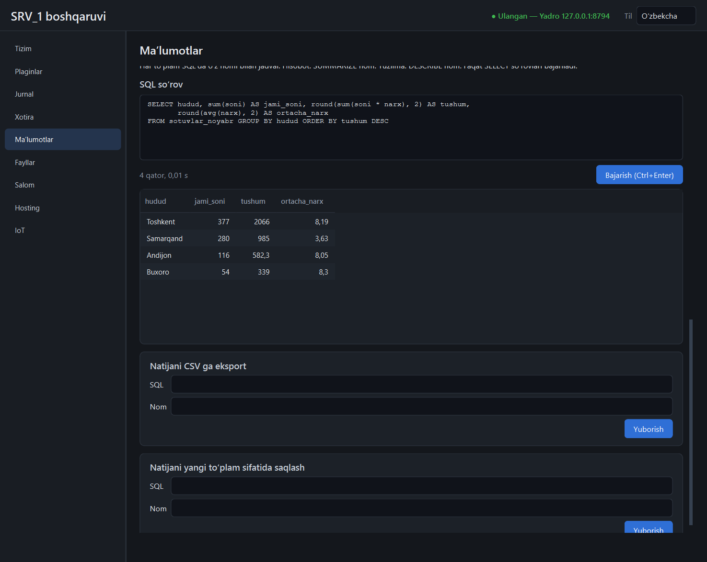

# `data` plagini

CSV, Parquet va Excel fayllarni import qiladi, ular ustida DuckDB bilan SQL
so'rovlar bajaradi, ustunlar bo'yicha hisobot beradi va natijani eksport qiladi.



## Og'ir plagin

`heavy = true`: **standart holatda o'chiq**, alohida jarayonda ishlaydi va
700 MB RAM limiti bilan cheklangan. Kerak bo'lganda shell'ning «Plaginlar»
sahifasida yoki API orqali yoqiladi:

```powershell
Invoke-RestMethod -Method Post http://127.0.0.1:8710/api/v1/plugins/data/enable -Headers $h
```

Ishlatib bo'lgach o'chirib qo'ying — 4 GB li mashinada bu sezilarli xotira.
`polars` va DuckDB plagin yoqilganda emas, birinchi import yoki so'rovda yuklanadi.

## Import

Fayllar ikki joydan olinadi:

- **`inbox`** — `<ma'lumotlar>/plugins/data/data/inbox/`; har doim ruxsat etilgan.
  Faylni shu yerga tashlang — panelda ko'rinadi.
- **Manifestdagi papkalar** — `plugins/data/plugin.toml` → `permissions.paths`
  (mutlaq yo'l bilan import qilinadi). Ro'yxatda yo'q joy — 403.

| Format | Kengaytma | Qanday o'qiladi |
|--------|-----------|-----------------|
| CSV | `.csv`, `.tsv`, `.txt` | oqim bilan — fayl xotiraga to'liq yuklanmaydi |
| Parquet | `.parquet`, `.pq` | oqim bilan |
| Excel | `.xlsx`, `.xlsm`, `.xls`, `.xlsb`, `.ods` | to'liq (`fastexcel`); bitta varaq |

CSV uchun:

- **kodirovka** o'zi aniqlanadi: UTF-8 yoki `cp1251` (kirillcha Windows
  fayllari); `encoding` bilan aniq berish mumkin;
- **ajratgich** o'zi aniqlanadi (`,` `;` tab `|`); `separator` bilan aniq beriladi;
- sanalar avtomatik taniladi; turlar birinchi 10 000 qator bo'yicha aniqlanadi.

Excel uchun `sheet` — varaq nomi yoki tartib raqami (1 dan); berilmasa birinchisi.

Har to'plam ichkarida Parquet (`datasets/<nom>.parquet`). Nom berilmasa fayl
nomidan olinadi: `Sotuvlar 2026.csv` → `sotuvlar_2026`. Shu nom bilan qayta
import eski to'plamni almashtiradi. Import fonda ketadi; holati to'plamlar
ro'yxatida: `importing` → `ready` yoki `failed` (sababi `error` da).
Muvaffaqiyatsiz import yarim fayl qoldirmaydi.

## So'rovlar

Har to'plam SQL'da o'z nomi bilan jadval:

```sql
SELECT hudud, sum(soni * narx) AS tushum
FROM sotuvlar_2026 GROUP BY hudud ORDER BY tushum DESC;

SUMMARIZE sotuvlar_2026;   -- hisobot: har ustun bo'yicha statistika
DESCRIBE sotuvlar_2026;    -- tuzilma: ustun nomlari va turlari
```

Cheklovlar (ataylab):

- **Faqat bitta `SELECT`** (`SUMMARIZE`, `DESCRIBE`, `EXPLAIN` ham).
  `COPY`, `CREATE`, `DROP`, `INSERT`, `DELETE`, `SET`, `ATTACH`, `INSTALL`,
  `PRAGMA` — 403.
- **Tashqi fayllarga murojaat yopiq**: `read_csv('C:/...')`,
  `SELECT * FROM 'fayl'`, `https://...` — rad etiladi. So'rov faqat import
  qilingan to'plamlarni ko'radi. Bu DuckDB sozlamasi darajasida
  (`enable_external_access = false`, qulflangan), faqat matn tekshiruvi emas.
- **Xotira**: DuckDB `memory_limit = '400MB'`; yetmasa so'rov 507 bilan
  to'xtaydi, plagin ishlayveradi. Katta saralashlar diskka (`tmp/`, 2 GB gacha)
  to'kiladi.
- **Vaqt**: 25 soniyadan oshgan so'rov to'xtatiladi (408).
- **Natija**: ko'pi bilan 1000 qator (`limit`/`offset` bilan sahifalanadi);
  500 belgidan uzun katak qisqartiriladi. To'liq natija kerak bo'lsa — eksport.

Sozlama: `<ma'lumotlar>/plugins/data/data/data.json` → `config`
(`memory_limit`, `threads`, `query_timeout_s`, `max_rows`, `temp_limit`).

## Hisobot va eksport

- **Hisobot** — `GET /profile?name=` yoki `SUMMARIZE nom`: har ustun uchun
  tur, min, max, taxminiy noyob qiymatlar soni, o'rtacha, standart og'ish,
  kvartillar, qatorlar soni va bo'sh qiymatlar ulushi.
- **CSV eksport** — `POST /export {sql, name}` → `exports/<name>.csv`
  (to'liq natija, 1000 qator chegarasisiz).
- **Yangi to'plam** — `POST /save {sql, name}`: so'rov natijasi to'plam
  bo'lib saqlanadi va keyingi so'rovlarda ishlatiladi.

Hisobot shell'da jadval bo'lib chiqadi; HTML hisobot yo'q.

## API

Hammasi `/api/v1/plugins/data/api` ostida (plagin yoqilgan bo'lsa; aks holda 409).

| Yo'l | Vazifa |
|------|--------|
| `GET /status` | to'plamlar, qatorlar, hajm, chegaralar |
| `GET /datasets` | to'plamlar va import holati |
| `GET /inbox` | `inbox` dagi import qilsa bo'ladigan fayllar |
| `POST /import` `{path, name, encoding, separator, sheet}` | importni boshlaydi (202) |
| `POST /remove` `{name}` | to'plamni o'chiradi (auditga yoziladi) |
| `GET /schema?name=`, `GET /preview?name=&limit=`, `GET /profile?name=` | tuzilma, namuna, hisobot |
| `POST /query` `{sql, limit, offset}` | `{columns, rows, truncated, seconds}` |
| `POST /export`, `POST /save` `{sql, name}` | CSV fayl / yangi to'plam |

Hodisa: `plugin.data.imported` `{name, state, rows, error}`.

## O'lchovlar (2026-11-11, bitta yugurish)

1 000 000 qator, 6 ustun, CSV 39,1 MB (sun'iy, takrorlanuvchi ma'lumot):

| O'lchov | Natija |
|---------|--------|
| import (CSV → Parquet) | 0,41 s |
| Parquet hajmi | 1,2 MB |
| `count(*)` | 0,006 s |
| guruhlash (7 va 500 guruh) | 0,01 s |
| filtr + saralash | 0,02 s |
| to'liq saralash (1 mln qator) | 0,13 s |
| `SUMMARIZE` (hisobot) | 0,33 s |
| CSV eksport (125 000 qator, 4,9 MB) | 0,05 s |

Plagin jarayoni xotirasi (Working Set):

| Holat | MB |
|-------|----|
| yoqilgandan keyin (kutubxonalar yuklanmagan) | 43,9 |
| import paytidagi cho'qqi | 187,0 |
| butun sinov cho'qqisi | 222,4 |
| ishlatilgandan 15 s keyin | 154,1 |

Sun'iy ma'lumot juda yaxshi siqiladi; haqiqiy fayllarda Parquet hajmi va
vaqtlar kattaroq bo'ladi. 4 GB li mashinada o'lchanmagan.

## Cheklovlar

- Excel fayl to'liq xotiraga o'qiladi; juda katta varaqlar limitga urilishi mumkin.
- CSV kodirovkasi faqat UTF-8 va `cp1251`; boshqalari (masalan UTF-16) uchun
  faylni oldindan o'giring.
- Import jarayonini bekor qilish yo'q; foiz ko'rsatkichi yo'q.
- Yadro plagin so'rovini 30 s kutadi — so'rov chegarasi shundan kichik (25 s).
- Panelda grafik yo'q; eksport va saqlash formalarida SQL bir qatorli maydonda.
- To'plam nomlari faqat lotin kichik harflari, raqam va `_`.
