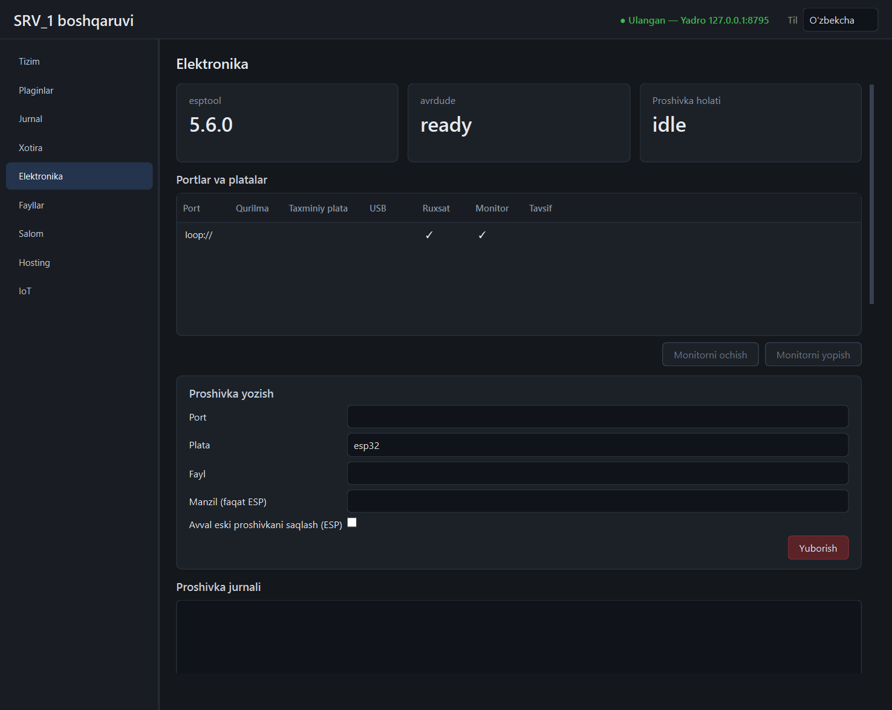
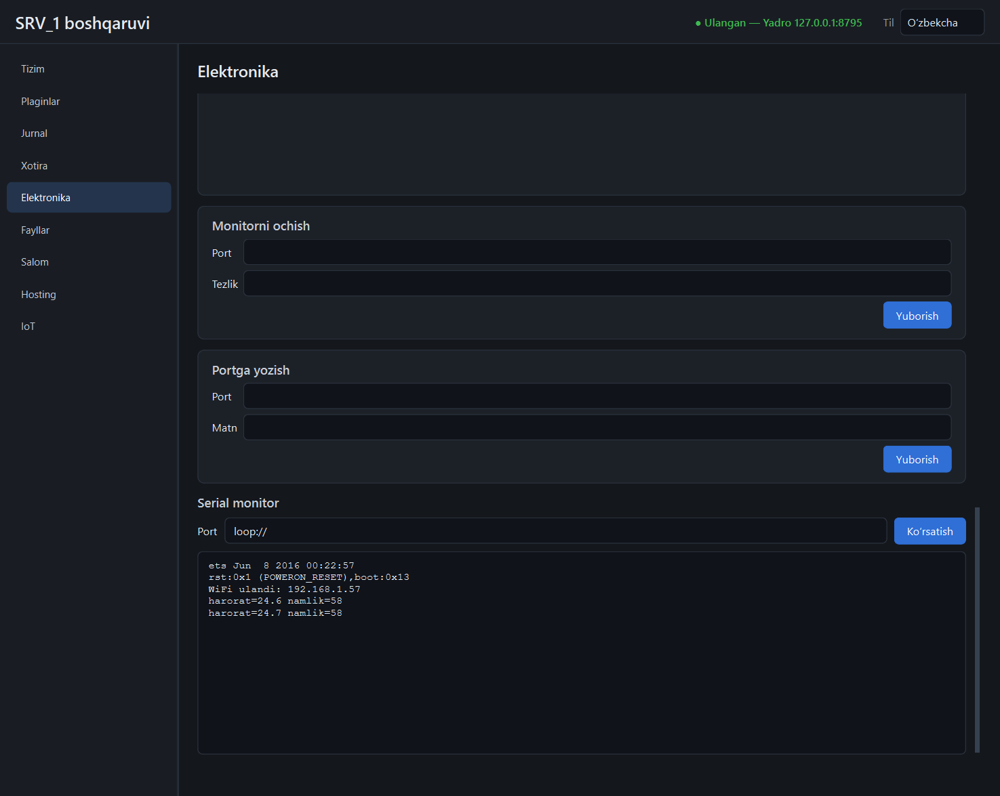

# `electronics` plagini

Ulangan platalarni aniqlaydi, serial monitor beradi va proshivka yozadi:
ESP platalariga `esptool`, AVR (Arduino) platalariga `avrdude` bilan.



> **Muhim.** Bu bosqich yozilgan mashinada birorta COM port va plata yo'q edi.
> Haqiqiy plataga **birorta bayt yozilmagan**. Nima sinalgani va nima
> sinalmagani — [oxirida](#sinalgan-va-sinalmagan).

## Portlarga ruxsat

Plagin faqat manifestda sanab o'tilgan portlarni ochadi va ularga yozadi:

```toml
# plugins/electronics/plugin.toml
[permissions]
serial = ["COM3", "COM4"]
```

Ro'yxatda yo'q port — 403. Panelning «Portlar va platalar» jadvalidagi
«Ruxsat» ustuni shuni ko'rsatadi. Manifest o'zgargach yadroni qayta ishga
tushiring. `loop://` (xotiradagi halqa port) monitor uchun har doim ochiq —
qurilmasiz sinash uchun; unga proshivka yozib bo'lmaydi.

## Platani aniqlash

`GET /ports` har port uchun USB identifikatorini (`VID:PID`) va shu bo'yicha
taxminni qaytaradi:

| USB | «Qurilma» | «Taxminiy plata» |
|-----|-----------|------------------|
| `2341:0043`, `2341:0001`, `2A03:0043` | Arduino Uno | `uno` |
| `2341:0042`, `2341:0010`, `2A03:0042` | Arduino Mega 2560 | `mega2560` |
| `1A86:7523` / `1A86:55D4` | CH340 / CH9102 | — |
| `10C4:EA60` | CP210x | — |
| `0403:6001` / `0403:6015` | FTDI | — |
| `303A:*` | Espressif USB | — |

CH340, CP210x va FTDI — faqat USB-UART ko'prigi: orqasida ESP32 turibdimi yoki
Arduino Nano nusxasimi, USB'dan bilib bo'lmaydi. Shuning uchun plata **har
doim qo'lda tanlanadi**; taxmin faqat maslahat.

## Proshivka yozish

1. Faylni `<ma'lumotlar>/plugins/electronics/data/firmware/` ga qo'ying
   (yoki manifestdagi `permissions.paths` papkasidan mutlaq yo'l bilan bering).
2. Panelda «Proshivka yozish»: port, plata, fayl → «Yuborish» → tasdiq.
3. «Proshivka jurnali» dastur chiqishini jonli ko'rsatadi.

| Plata (`board`) | Dastur | Fayl | Standart manzil / tezlik |
|-----------------|--------|------|--------------------------|
| `esp32`, `esp32s2`, `esp32s3`, `esp32c3`, `esp32c6` | esptool | `.bin` | `0x10000`, 460800 |
| `esp8266` | esptool | `.bin` | `0x0`, 460800 |
| `uno`, `nano` | avrdude (`arduino`) | `.hex` | 115200 |
| `nano_old` (eski bootloader) | avrdude (`arduino`) | `.hex` | 57600 |
| `mega2560` | avrdude (`wiring`) | `.hex` | 115200 |

**ESP manzili.** ESP32 oilasida ilova `0x10000` da turadi (undan oldin
bootloader va bo'limlar jadvali). Arduino IDE/PlatformIO'ning oddiy
`firmware.bin` fayli — shu manzilga. Birlashtirilgan (merged) tasvir uchun
«Manzil» maydoniga `0x0` yozing. Noto'g'ri manzil platani buzmaydi (ESP'ning
yuklovchisi ROM'da), lekin ilova ishga tushmaydi — to'g'ri manzil bilan qayta yozing.

ESP uchun qo'shimcha (faqat API'da `baudrate`, `erase`; panelda `offset`, `backup`):

- `backup` — yozishdan **oldin** butun flesh xotirani
  `firmware/backups/<port>-<plata>-<vaqt>.bin` ga o'qiydi (4 MB uchun bir necha
  daqiqa). Zaxira o'tmasa, yozishga o'tilmaydi. Qaytarish: shu faylni `0x0`
  manziliga yozing.
- `erase` — yozishdan oldin butun xotirani o'chiradi.
- `baudrate` — 115200, 230400, 460800 yoki 921600.

Leonardo/Micro (ATmega32U4) qo'llab-quvvatlanmaydi: ular yozishdan oldin
portni 1200 bodda «teginish» bilan qayta yuklashni talab qiladi.

### Xavfsizlik va cheklovlar

- Bir vaqtda **bitta** yozish. Ikkinchisi — 409.
- Dasturlar alohida jarayonda, `shell`siz, 256 MB limit bilan ishlaydi; yadro
  to'xtasa, ular ham o'ladi.
- Har urinish audit jurnaliga yoziladi: `firmware.flash` (port, plata, fayl,
  SHA-256, natija) va har jarayon uchun `process.spawn`.
- Bosqich (zaxira yoki yozish) 300 soniyadan oshsa, to'xtatiladi
  (`electronics.json` → `config.timeout_s`).
- «Yozishni to'xtatish» jarayonni o'ldiradi. **Yarim yozilgan plata ishlamaydi**
  — qayta yozish kerak (bootloader saqlanib qoladi).
- Fayl: `.bin` ≤ 32 MB, `.hex` ≤ 4 MB, bo'sh bo'lmasin; kengaytma plataga mos
  kelmasa — 400. Ruxsat etilgan papkalardan tashqari yo'l — 403.

### Port band bo'lsa

Windows'da COM port bitta egaga tegishli. Yozishdan oldin plagin:

- o'zining monitori shu portda ochiq bo'lsa — uni **o'zi yopadi** (keyin qayta
  ochmaydi);
- port tizimda yo'q bo'lsa — 404 «plata ulanmagan»;
- portni boshqa dastur yoki `iot` plagini ochgan bo'lsa — 409 «band» va hech
  narsa ishga tushmaydi. Avval o'sha yerda yoping (`iot` panelida «Yopish»).

Tekshiruv portni bir lahzaga ochib-yopadi; bu ko'p platalarni qayta yuklaydi
(DTR) — yozish oldidan bu zararsiz.

## Serial monitor

«Monitorni ochish» (tezlik berilmasa 115200) → «Serial monitor» da port nomini
yozib «Ko'rsatish». Oxirgi 300 satr saqlanadi; har satr `plugin.electronics.serial`
hodisasi bo'lib ham chiqadi. Telemetriyaga yozish kerak bo'lsa `iot` plaginining
serial qismidan foydalaning — bu monitor faqat ko'rsatadi.



Serial kodi (`srv1_sdk/serialport.py`) `iot` bilan umumiy.

## Dasturlar

| Dastur | Qayerdan | Sinalgan versiya |
|--------|----------|------------------|
| esptool | Python paketi (`uv` o'rnatadi), `python -m esptool` | 5.6.0 |
| avrdude | `tools/avrdude/avrdude.exe` (+ yonida `avrdude.conf`) yoki `SRV1_AVRDUDE_EXE` | 8.3 |

O'rnatish: [tools/README.md](../tools/README.md). `electronics.json` →
`config.esptool` / `config.avrdude` buyruq boshini almashtiradi (masalan,
boshqa joydagi dastur): `{"config": {"avrdude": ["D:/avr/avrdude.exe", "-C", "D:/avr/avrdude.conf"]}}`.

## API

Hammasi `/api/v1/plugins/electronics/api` ostida.

| Yo'l | Vazifa |
|------|--------|
| `GET /status` | dasturlar holati, yozish holati, ruxsat etilgan portlar |
| `GET /ports` | portlar: `usb`, `chip`, `board`, `allowed`, `monitor`, `flashing` |
| `GET /boards` | platalar ro'yxati |
| `GET /firmware` | `firmware` papkasidagi `.bin`/`.hex` fayllar |
| `POST /monitor/open` `{port, baudrate}`, `/monitor/close` `{port}` | monitor |
| `POST /monitor/write` `{port, text, newline}`, `GET /monitor/lines?port=&tail=` | yozish / o'qish |
| `POST /flash` `{port, board, file, offset, baudrate, backup, erase}` | yozishni boshlaydi (202) |
| `GET /flash`, `GET /flash/log?tail=`, `GET /flash/history` | holat, jurnal, oxirgi 20 urinish |
| `POST /flash/cancel` | to'xtatish |

Hodisalar: `plugin.electronics.flash` (holat o'zgarganda), `plugin.electronics.serial`.

## Sinalgan va sinalmagan

**Sinalgan** (`tests/test_electronics_plugin.py`, 12 test):

- USB identifikatori bo'yicha aniqlash, ruxsatlar, monitor (`loop://` orqali).
- Yozish oqimi **soxta dastur** bilan: muvaffaqiyat, zaxira → yozish tartibi,
  xato kodi, vaqt tugashi, to'xtatish, yadro to'xtaganda jarayonning o'lishi,
  audit yozuvlari, barcha rad etishlar (15 holat), band va yo'q port.
- **Haqiqiy esptool 5.6.0 va avrdude 8.3** bizning buyruq satrimiz bilan ishga
  tushirilgan: ikkalasi ham argumentlarni qabul qilib, portni ochishgacha
  borgan va «port ochilmadi» deb tugagan (plata yo'q). Ya'ni buyruq sintaksisi
  to'g'ri; undan narisi sinalmagan.

**Sinalmagan:**

- Haqiqiy plataga yozish (ESP ham, AVR ham) va haqiqiy zaxira o'qish.
- Haqiqiy COM portda monitor; «port band» holati haqiqiy ikki dastur bilan
  (test portni soxta «ruxsat yo'q» xatosi bilan band qiladi).
- avrdude'ning `-U flash:w:<fayl>:i` qismi fayl bosqichigacha yetmagan
  (port undan oldin ochiladi).
- avrdude xato matni Windows tizim xabarini OEM kodirovkada chiqaradi —
  jurnalda u buzuq belgilar bo'lib ko'rinadi (dasturning o'z inglizcha
  satrlari to'g'ri).
- esptool/avrdude jarayonining xotira sarfi o'lchanmagan.

Plata ulaganingizda: manifestga portni qo'shing, kichik `blink` proshivkasini
`backup` bilan yozib ko'ring va natijani shu yerga yozib qo'ying.
