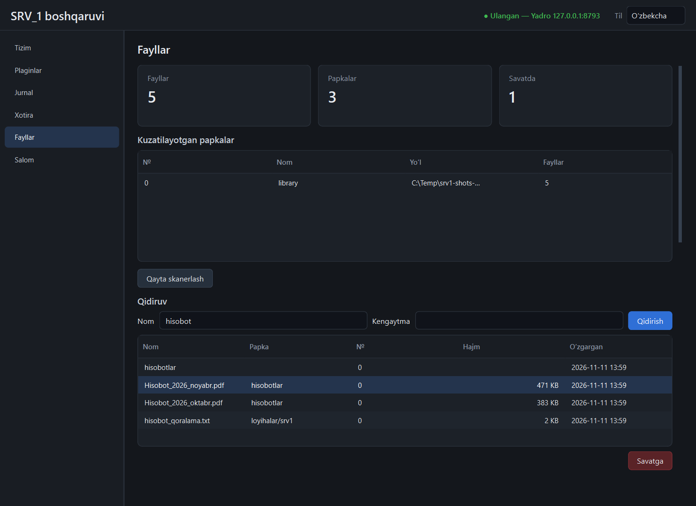

# `files` plagini

Yadro ichida ishlaydi (skanerlash va disk amallari alohida oqimlarda).
Papkalarni kuzatadi, fayl nomlari indeksini yuritadi, nom bo'yicha qidiradi va
asosiy amallarni bajaradi. O'chirilgan narsa savatga tushadi va tiklanadi.



## Papkalar (ildizlar)

- **0-ildiz** — plaginning o'z papkasi: `<ma'lumotlar>/plugins/files/data/library`.
  Har doim bor, hech qanday ruxsat talab qilmaydi.
- **Qolganlari** — `plugins/files/plugin.toml` dagi `permissions.paths`:

  ```toml
  [permissions]
  paths = ["D:/Hujjatlar", "C:/Users/men/Downloads"]
  ```

  O'zgartirgandan keyin plaginni o'chirib-yoqing. Ro'yxatda yo'q papkaga
  plagin murojaat qila olmaydi (403).

API'da yo'l har doim juftlik: `root` (ildiz raqami) va `path` (ildizga
nisbatan, `/` bilan). Ildizdan tashqariga chiqadigan har qanday yo'l
(`..`, mutlaq yo'l, simvolik havola orqali) rad etiladi.

## Indeks va qidiruv

- Indeks: `<ma'lumotlar>/plugins/files/data/index.db` (SQLite, FTS5 trigram).
- Faqat **nom** indekslanadi (fayl ichi emas): nom, kengaytma, hajm, o'zgargan vaqt.
- Qidiruv nom ichidan, katta-kichik harf farqsiz, har qanday alifboda:
  `sobot` → `Hisobot_2026.pdf`, `ноябрь` → `Отчёт за ноябрь.docx`.
- 3 belgidan qisqa so'rov oddiy `LIKE` bilan bajariladi (sekinroq, lekin ishlaydi).
- Simvolik havola va junction'larga kirilmaydi: ular indeksga tushmaydi, ular orqali
  hech bir amal bajarilmaydi (403). `GET /list` da `link: true` belgisi bilan
  ko'rinadi; havolaning **o'zini** `POST /unlink` olib tashlaydi (nishon qoladi).

Indeks uch yo'l bilan yangilanadi:

1. **To'liq skanerlash** — plagin yoqilganda, har 6 soatda va `POST /rescan` bilan.
2. **Kuzatuv** (`watchdog`) — tashqi o'zgarish taxminan 1,6 soniyada indeksga tushadi.
3. **Plaginning o'z amallari** — darhol.

## API

Hammasi `/api/v1/plugins/files/api` ostida.

| Yo'l | Vazifa |
|------|--------|
| `GET /status` | fayllar, papkalar, savat soni, oxirgi skanerlash |
| `GET /roots` | ildizlar ro'yxati |
| `GET /list?root=&path=` | papka ichi (diskdan, jonli) |
| `GET /search?q=&ext=&root=&min_size=&max_size=&limit=` | indeks bo'yicha qidiruv |
| `POST /rescan` | to'liq skanerlash |
| `POST /mkdir` `{root, path}` | papka yaratish |
| `POST /rename` `{root, path, new_name}` | nomini o'zgartirish |
| `POST /move`, `POST /copy` `{root, path, dest_root, dest_path}` | `dest_path` papkasi ichiga |
| `POST /delete` `{root, path}` | savatga ko'chirish |
| `POST /unlink` `{root, path}` | simvolik havola yoki junction'ning o'zini olib tashlash; nishonga tegilmaydi, savatga tushmaydi; auditda `file.unlink` |
| `GET /trash` | savat |
| `POST /trash/restore` `{id}` | asl joyiga tiklash |
| `POST /trash/purge` `{id}`, `DELETE /trash` | butunlay o'chirish (qaytarib bo'lmaydi) |

Xato kodlari: 400 — yaroqsiz so'rov (ildizni o'chirish, papkani o'ziga
ko'chirish, yaroqsiz nom); 403 — ildizdan tashqari yo'l; 404 — topilmadi;
409 — manzilda shu nomli narsa bor (**hech qachon ustidan yozilmaydi**).

Hodisalar: `plugin.files.changed` `{count, paths[]}` (kuzatuv),
`plugin.files.scan` `{entries, seconds}`.

Audit (`actor = plugin:files`): `file.rename`, `file.move`, `file.copy`,
`file.trash`, `file.restore`, `file.delete`.

## Savat

`POST /delete` faylni `<ma'lumotlar>/plugins/files/data/trash/<id>/` ga
ko'chiradi. Tiklashda asl joyi band bo'lsa — 409, ustidan yozilmaydi. Savat
o'zi tozalanmaydi; `DELETE /trash` yoki paneldagi tugma bilan bo'shatiladi.

## O'lchovlar (2026-11-11, bitta yugurish)

20 000 fayl, 400 papka, SSD:

| O'lchov | Natija |
|---------|--------|
| birinchi to'liq skanerlash | 0,41 s |
| qayta skanerlash (o'zgarishsiz) | 0,23 s |
| qidiruv: aniq nom | 8 ms |
| qidiruv: 1000 natija | 30 ms |
| qidiruv: 2 belgi (`LIKE`) | 12 ms |
| `index.db` hajmi | 5,0 MB |

100 000 fayl bilan o'lchov (yadro ichida, 2026-11-13): [sinov-2026-11-13.md](sinov-2026-11-13.md#katta-hajmlar).

Vaqtlar API orqali o'lchangan. O'lchov paytida plagin alohida jarayonda edi
(52 MB); 5-bosqichda yadro ichiga ko'chirildi — vaqtlar qayta o'lchanmagan,
jarayonlararo uzatish yo'qolgani uchun yomonlashmagan bo'lishi kerak.

## Cheklovlar

- Katta fayl yoki papkani ko'chirish/nusxalash so'rov ichida bajariladi va
  jarayon ko'rsatkichi yo'q; klient javobni amal tugaguncha kutadi.
- Boshqa diskka ko'chirish va savatga tashlash — aslida nusxalash + o'chirish.
- Kuzatuv ishlamay qolsa (masalan tarmoq diski), o'zgarishlar faqat keyingi
  to'liq skanerlashda ko'rinadi.
- Fayl ichidan qidirish yo'q.
- Panelda papkalar bo'ylab «yurish» yo'q: qidiruv jadvali va formalar bor.
  Yo'l va ildiz raqami qo'lda kiritiladi.
