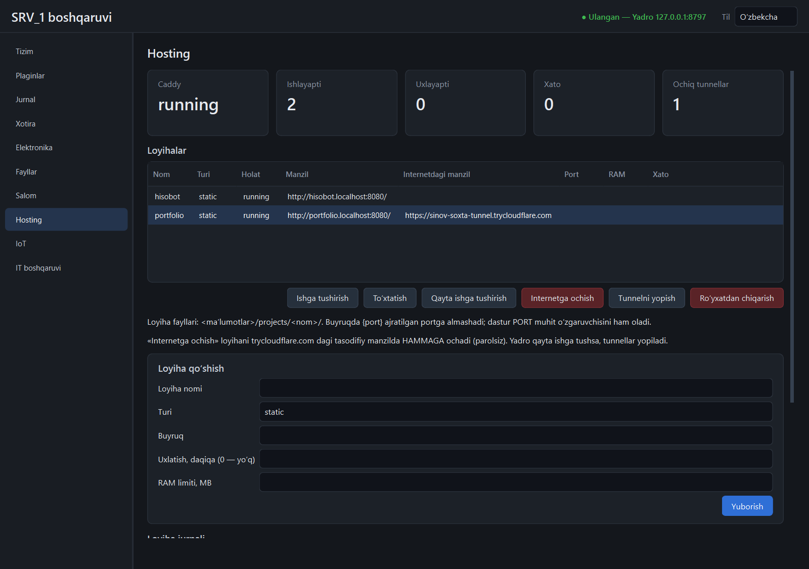

# `hosting` plagini

Statik sayt, Python va Node loyihalarini Caddy ortida ishlatadi. Yadro ichida
ishlaydi; Caddy va har loyiha — alohida jarayon, Job Object ichida.



(Skrinshotdagi internet manzili — sinov uchun soxta cloudflared'niki; haqiqiy
tunnelda u tasodifiy so'zlardan iborat bo'ladi.)

## Tez boshlash

1. `tools/caddy.exe` bo'lishi kerak ([tools/README.md](../tools/README.md)).
2. Loyiha fayllarini `<ma'lumotlar>/projects/<nom>/` ga qo'ying.
3. Panelda «Loyiha qo'shish» yoki API orqali:

   ```powershell
   $h = @{ Authorization = "Bearer $token" }
   $api = "http://127.0.0.1:8710/api/v1/plugins/hosting/api"
   # statik sayt
   Invoke-RestMethod -Method Post "$api/projects" -Headers $h -ContentType application/json `
     -Body '{"name":"sayt","kind":"static"}'
   # Python
   Invoke-RestMethod -Method Post "$api/projects" -Headers $h -ContentType application/json `
     -Body '{"name":"api","kind":"python","command":"python app.py"}'
   ```

4. Brauzerda: `http://sayt.localhost:8080/`.

`*.localhost` ni brauzerlar o'zi `127.0.0.1` ga yo'naltiradi. Boshqa
dasturlarda (masalan `curl`) `Host` sarlavhasini qo'lda bering:
`curl -H "Host: sayt.localhost:8080" http://127.0.0.1:8080/`.

## Loyiha turlari

| Tur | Nima ishlaydi | `command` |
|-----|---------------|-----------|
| `static` | Caddy `file_server`; jarayon yo'q | bo'lmaydi; `root` — papka ichidagi ildiz |
| `python` | sizning buyrug'ingiz | masalan `python app.py`, `python -m uvicorn main:app --port {port}` |
| `node` | sizning buyrug'ingiz | masalan `node server.js` |

Buyruq qoidalari:

- **`shell` ishlatilmaydi.** Buyruq bo'laklarga ajratiladi va to'g'ridan-to'g'ri
  bajariladi; `&&`, `|`, `>` ishlamaydi.
- `{port}` ajratilgan portga almashadi. Dastur `PORT` va `HOST=127.0.0.1`
  muhit o'zgaruvchilarini ham oladi.
- Birinchi so'z: loyiha papkasidagi fayl (masalan `.venv/Scripts/python.exe`),
  yoki `python` (tizim interpretatori), yoki `PATH` dagi dastur.
- **`.cmd`/`.bat` rad etiladi** (`npm start` ham — `npm` aslida `npm.cmd`):
  Windows ularni yashirin `cmd.exe` orqali bajaradi. `node server.js` deb yozing.
- Loyiha `127.0.0.1:<port>` da tinglashi kerak; aks holda «port ochilmadi».

## Holatlar

| Holat | Ma'nosi | Saytga so'rov |
|-------|---------|---------------|
| `running` | ishlayapti | loyihaga boradi |
| `sleeping` | uxlatilgan (jarayon yo'q) | loyihani uyg'otadi |
| `stopped` | qo'lda to'xtatilgan | 404 |
| `failed` | ishga tushmadi yoki yiqildi; `error` da sabab | 503 |
| `starting` | ishga tushmoqda | kutadi |

Yiqilgan loyiha o'zi qayta ishga tushmaydi — sababini ko'rib, «Ishga tushirish»ni bosing.

## Uxlatish va uyg'otish

`idle_minutes` (standart 15) davomida so'rov kelmasa, jarayon to'xtatiladi va
RAM bo'shaydi. Keyingi so'rov:

1. Caddy uni plaginning uyg'otish xizmatiga (`127.0.0.1:9099`) beradi;
2. xizmat loyihani ishga tushiradi va port ochilishini kutadi;
3. brauzerga `307` qaytaradi — brauzer shu so'rovni (metodi va tanasi bilan)
   qayta yuboradi, endi u loyihaga yetadi.

Foydalanuvchi uchun bu birinchi so'rovning sekinroq ochilishi, xolos.
`idle_minutes = 0` — hech qachon uxlatilmaydi. Statik saytlar uxlatilmaydi
(jarayoni yo'q). Faollik Caddy'ning so'rovlar jurnalidan o'qiladi.

`curl` kabi 307 ga o'zi ergashmaydigan klientlarda `-L` kerak.

## Portlar va tashqi kirish

| Port | Vazifa |
|------|--------|
| 8080 | saytlar (Caddy) |
| 2019 | Caddy admin API (faqat `127.0.0.1`) |
| 9000–9098 | loyihalar; faqat tirik loyiha portni band qiladi |
| 9099 | uyg'otish xizmati |

Sozlama: `<ma'lumotlar>/plugins/hosting/data/hosting.json` → `config`
(`listen_host`, `listen_port`, `admin_port`, `wake_port`, `port_first`,
`port_last`, `domain`, `ready_timeout_s`, `tunnel_max`, `tunnel_timeout_s`). Portlar manifestdagi
`permissions.ports` ichida bo'lishi shart.

**Standart holatda saytlar faqat shu kompyuterdan ochiladi.** Mahalliy
tarmoqqa ochish uchun `listen_host` ni o'zgartirib, `allow_non_loopback: true`
qo'shing; busiz plagin ishga tushmaydi.

## Internetga ochish (cloudflared)

Standart holatda hech narsa tashqariga ochilmaydi. «Internetga ochish»
(`POST /tunnel/open {name}`) shu loyiha uchun `cloudflared` ni ishga tushiradi:

```
cloudflared tunnel --no-autoupdate --url http://127.0.0.1:8080 --http-host-header <nom>.localhost
```

Bu Cloudflare'ning akkauntsiz «quick tunnel»i: cloudflared tashqariga
**chiquvchi** ulanish ochadi va `https://<tasodifiy>.trycloudflare.com`
manzilini beradi (jurnalidan o'qiladi, 30 s kutiladi). Mashinada hech qanday
port tashqariga ochilmaydi, `listen_host` loopback'ligicha qoladi. So'rovlar
Caddy orqali o'tadi, shuning uchun uxlayotgan loyiha tunnel orqali ham uyg'onadi
va faollik hisoblanadi.

- **Parol yo'q:** manzilni bilgan har kim ochadi. Panelda tasdiq so'raladi.
- Tunnel **saqlanmaydi**: yadro yoki plagin qayta ishga tushsa, hammasi yopiq.
- Loyiha to'xtatilsa yoki ro'yxatdan chiqarilsa, tunneli yopiladi; uxlatilsa — yo'q.
- Bir vaqtda ko'pi bilan `tunnel_max` (standart 2) ta; har biri alohida
  cloudflared jarayoni, 192 MB limit bilan.
- Faqat `running` yoki `sleeping` loyiha ochiladi (aks holda 409).
- `tools/cloudflared.exe` yo'q bo'lsa — 503, `GET /status` da `cloudflared: missing`.
- Auditga yoziladi: `hosting.tunnel_open` (muvaffaqiyatsizi ham, sababi bilan),
  `hosting.tunnel_close` (sababi bilan), cloudflared'ning o'zi — `process.spawn`.

O'z domeningiz bilan doimiy (nomli) tunnel **qilinmagan**: u Cloudflare
akkaunti va tunnel tokenini (sir) talab qiladi.

**Sinalgani:** butun oqim soxta cloudflared bilan (argumentlar, manzilni
o'qish, chegara, yopilish, xatolar); haqiqiy `cloudflared.exe` ishga tushishi
va bayroqlarni bilishi. **Haqiqiy tunnel biror marta ham ochilmagan** — u
saytni internetga chiqaradi, buni faqat egasi qiladi. Demak Cloudflare tomoni,
haqiqiy manzil formati va haqiqiy cloudflared'ning RAM sarfi tekshirilmagan.

## API

Hammasi `/api/v1/plugins/hosting/api` ostida.

| Yo'l | Vazifa |
|------|--------|
| `GET /status` | Caddy holati, RAM, loyihalar soni |
| `GET /projects` | loyihalar: holat, manzil, port, pid, RAM, xato |
| `POST /projects` | yangi loyiha (`name`, `kind`, `command`, `root`, `idle_minutes`, `memory_limit_mb`, `autostart`, `start`) |
| `POST /start`, `/stop`, `/restart` `{name}` | boshqaruv |
| `POST /remove` `{name}` | ro'yxatdan chiqarish — **fayllar o'chirilmaydi** |
| `POST /tunnel/open`, `/tunnel/close` `{name}` | internetga ochish va yopish; javobda `public_url` |
| `GET /log?name=&tail=` | loyiha chiqishining oxirgi satrlari |

Loglar: `<ma'lumotlar>/plugins/hosting/data/logs/<nom>.log` (1 MB dan oshsa
`.log.1` ga aylanadi).

Hodisalar: `plugin.hosting.state` `{name, state, error}`,
`plugin.hosting.tunnel` `{name, url}` (`url = null` — yopildi).

Audit (`actor = plugin:hosting`): `process.spawn` (Caddy va har loyiha
ishga tushishi, to'liq buyruq bilan), `hosting.project_create`,
`hosting.project_stop`, `hosting.project_remove`.

## RAM

- Har loyihaga `memory_limit_mb` (standart 256). Limit butun jarayon
  daraxtiga tegishli; oshsa xotira ajratish rad etiladi va loyiha odatda
  yiqiladi (`failed`).
- Caddy ham limit ostida (256 MB).
- Yadro yoki plagin to'xtasa, Caddy va barcha loyihalar ham to'xtaydi.

## Cheklovlar

- Mahalliy manzillarda HTTPS yo'q (faqat `http://`). Tunnel manzili HTTPS,
  lekin tasodifiy va vaqtinchalik; o'z domeni bilan doimiy tunnel qilinmagan.
- Loyiha o'rnatish (`pip install`, `npm install`) avtomatlashtirilmagan —
  bog'liqliklarni o'zingiz o'rnatasiz.
- Panelda holat va tur nomlari tarjimasiz (`running`, `static`).
- Loyihani tahrirlash yo'q: ro'yxatdan chiqarib, qayta qo'shiladi (fayllar qoladi).
- WebSocket va uzoq so'rovlar faollik sifatida faqat ulanish boshida
  hisoblanadi: uzoq ochiq turgan ulanish loyihani uxlashdan saqlamaydi.
