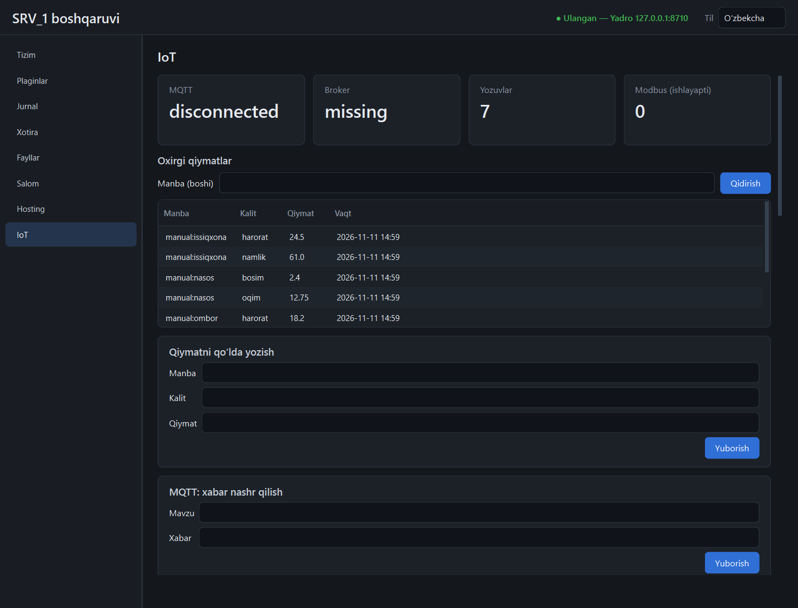

# `iot` plagini

MQTT, serial portlar va Modbus qurilmalaridan kelgan sonli qiymatlarni bitta
telemetriya omboriga yig'adi. Yadro ichida ishlaydi; bloklovchi kutubxonalar
(`paho-mqtt`, `pyserial`, `pymodbus`) o'z oqimlarida.



> **Sinov holati.** MQTT klient haqiqiy TCP orqali, lekin testdagi kichik
> broker bilan sinalgan — **haqiqiy Mosquitto bilan emas**. Serial faqat
> `loop://` soxta portida, Modbus faqat `pymodbus` simulyatorida (TCP)
> sinalgan — **haqiqiy qurilmada emas**. Modbus RTU umuman sinalmagan.

## Manbalar

Har qiymat `(manba, kalit, qiymat, vaqt)` ko'rinishida saqlanadi:

| Manba | Qayerdan | Kalitlar |
|-------|----------|----------|
| `mqtt:<mavzu>` | obuna bo'lingan MQTT xabarlari | quyidagi qoida bo'yicha |
| `serial:<port>` | ochiq serial portdan kelgan satrlar | quyidagi qoida bo'yicha |
| `modbus:<qurilma>` | davriy so'rov | registr `key` lari |
| `manual:<nom>` | `POST /telemetry/record` | berilgan kalitlar |

Matndan qiymat ajratish (MQTT xabari va serial satri uchun bir xil):

- bitta son: `21.5` → kalit `value`;
- JSON obyekt: `{"temp": 24.2, "hum": 61, "ok": true}` → sonli maydonlar
  (`true`/`false` → 1/0; matnli maydonlar tashlab ketiladi);
- juftliklar: `temp=21.5,hum=40` yoki `temp:21.5 hum:40`.

Son topilmasa, xabar faqat jurnalda ko'rinadi — telemetriyaga yozilmaydi.

## MQTT

Sozlama: `<ma'lumotlar>/plugins/iot/data/iot.json` → `mqtt`.

| Kalit | Standart | Izoh |
|-------|----------|------|
| `enabled` | `true` | `false` — MQTT butunlay o'chiq |
| `manage_broker` | `true` | Mosquitto'ni plagin ishga tushiradi; `false` — tashqi broker |
| `host`, `port` | `127.0.0.1`, `1883` | klient ulanadigan manzil |
| `listen_host` | `127.0.0.1` | broker tinglaydigan manzil |
| `allow_non_loopback` | `false` | tarmoqqa ochish uchun ataylab `true` |
| `username`, `password` | bo'sh | tarmoqqa ochiq brokerda majburiy (parol ≥ 8 belgi) |
| `subscriptions` | `["srv1/#"]` | obunalar (API orqali ham o'zgaradi) |

**Mosquitto.** `tools/mosquitto/mosquitto.exe` yoki standart o'rnatish joyidan
(`C:\Program Files\mosquitto`) topiladi; `SRV1_MOSQUITTO_EXE` bilan boshqa joy
beriladi. Topilmasa plagin ishlayveradi: holatda `broker: missing`, klient esa
tashqi broker paydo bo'lishini kutib qayta ulanib turadi.

**Tarmoqdagi qurilmalar (ESP32 va h.k.)** ulanishi uchun:

```json
{"mqtt": {"listen_host": "0.0.0.0", "allow_non_loopback": true,
          "username": "srv1", "password": "kamida-8-belgi"}}
```

Bunda broker anonim ulanishni rad etadi. Parol fayli plagin tomonidan yoziladi
(PBKDF2-SHA512). **Diqqat:** bu fayl formati haqiqiy Mosquitto bilan
sinalmagan; noto'g'ri bo'lsa broker hech kimni kiritmaydi (ochiq qolmaydi).
Parol `iot.json` da ochiq matnda turadi — faylni himoya qiling. API va
jurnallarda parol ko'rinmaydi.

Uzilgan aloqa o'zi tiklanadi (1–10 s oralig'ida), obunalar qayta o'rnatiladi.

## Serial

- Faqat manifestdagi `permissions.serial` da turgan portlar ochiladi
  (`plugins/iot/plugin.toml`: `serial = ["COM3"]`), aks holda 403.
- `loop://` — sinov porti: yozilgan narsa o'qishga qaytadi. Temir ham, tarmoq
  ham ishtirok etmaydi, shuning uchun har doim ruxsat etilgan.
- Boshqa `pyserial` manzillari (`socket://`, `rfc2217://`) rad etiladi (400).
- Har ochiq port alohida oqimda o'qiladi; oxirgi 300 satr xotirada.

## Modbus

Qurilma API orqali qo'shiladi (panelda forma yo'q — registrlar ro'yxati
murakkab):

```json
POST /api/v1/plugins/iot/api/modbus
{
  "name": "plc", "host": "192.168.1.50", "port": 502, "unit": 1, "interval_s": 5,
  "registers": [
    {"key": "harorat", "address": 0, "type": "int16", "scale": 0.1},
    {"key": "bosim",   "address": 1, "kind": "input"},
    {"key": "oqim",    "address": 4, "type": "float32"},
    {"key": "nasos",   "address": 3, "kind": "coil", "type": "bool"}
  ]
}
```

| Maydon | Qiymatlar |
|--------|-----------|
| `kind` | `holding` (standart), `input`, `coil`, `discrete` |
| `type` | `uint16` (standart), `int16`, `uint32`, `int32`, `float32`; bitlar uchun `bool` |
| `scale` | o'qilgan qiymat shunga ko'paytiriladi; yozishda teskari qo'llanadi |
| `transport` | `tcp` (standart) yoki `rtu` (`serial_port`, `baudrate`; port ruxsat etilgan bo'lishi shart) |

- 32 bitli turlar ikki registr egallaydi, so'z tartibi — katta so'z birinchi.
- Manzillar 0 dan (protokol manzili), hujjatdagi `40001` uslubida emas.
- Aloqa uzilsa qurilma `ok: false` va `error` bilan ko'rinadi; keyingi
  so'rovda qayta ulanadi.
- **Yozish** (`POST /modbus/write {name, key, value}`) — xavfli amal, har
  urinish auditga yoziladi (`modbus.write`, muvaffaqiyatsizi ham).

## Telemetriya

- Ombor: `<ma'lumotlar>/plugins/iot/data/telemetry.db` (SQLite). Yozuvlar
  1 soniyada bir marta to'plam bo'lib yoziladi.
- Saqlash muddati: `retention_days` (standart **30 kun**); eskilari soatiga
  bir marta va plagin yoqilganda o'chiriladi.
- «Oxirgi qiymat» — vaqt bo'yicha eng yangisi (yozilish tartibi bo'yicha emas).

## API

Hammasi `/api/v1/plugins/iot/api` ostida.

| Yo'l | Vazifa |
|------|--------|
| `GET /status` | MQTT/broker holati, yozuvlar soni, ochiq portlar, Modbus |
| `GET /telemetry/latest?source=` | oxirgi qiymatlar (`source` — manba boshi) |
| `GET /telemetry/series?source=&key=&minutes=&limit=` | vaqt qatori (oxirgi `limit` nuqta) |
| `POST /telemetry/record` | qo'lda yozuv: `{source, values{}}` yoki `{source, key, value}`; ixtiyoriy `ts` |
| `POST /telemetry/purge` | eskirgan yozuvlarni hozir o'chirish |
| `GET /mqtt/messages`, `GET /mqtt/log` | oxirgi 300 xabar |
| `POST /mqtt/publish` `{topic, payload, qos, retain}` | nashr (`qos` 0 yoki 1) |
| `GET /mqtt/subscriptions`, `POST /mqtt/subscribe`, `/mqtt/unsubscribe` `{topic}` | obunalar |
| `GET /serial/ports` | tizimdagi va ochiq portlar, ruxsat belgisi bilan |
| `POST /serial/open` `{port, baudrate}`, `/serial/close`, `/serial/write` `{port, text, newline}` | serial |
| `GET /serial/lines?port=&tail=` | serial monitor |
| `GET /modbus`, `POST /modbus`, `/modbus/remove`, `/modbus/poll`, `/modbus/write` | Modbus |

Hodisalar: `plugin.iot.telemetry` `{source, ts, <kalitlar>}`,
`plugin.iot.mqtt` `{topic, payload}`, `plugin.iot.serial` `{port, line}`,
`plugin.iot.mqtt_state` `{state}`.

## Cheklovlar

- Panelda holat nomlari tarjimasiz (`connected`, `missing`).
- Panelda grafik yo'q: vaqt qatori faqat API orqali (`/telemetry/series`).
- MQTT: TLS yo'q; QoS 2 yo'q; ikkilik (matn bo'lmagan) xabarlar telemetriyaga tushmaydi.
- Serial: faqat satrli (matn) protokol; ikkilik protokollar uchun emas.
- Modbus qurilmasini tahrirlash yo'q — olib tashlab, qayta qo'shiladi.
- Chiquvchi ulanishlar (Modbus TCP, tashqi MQTT broker) manifest bilan
  cheklanmagan: `permissions.ports` faqat tinglanadigan portlarga tegishli.
