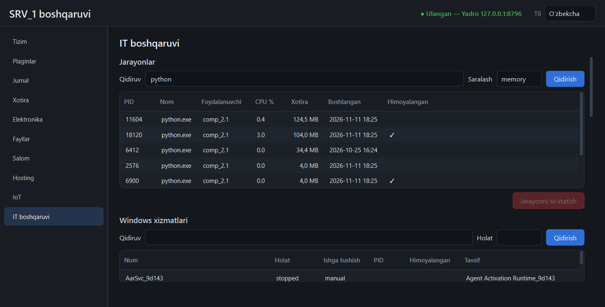

# `itops` plagini

IT administrlash: jarayonlar, Windows xizmatlari, mahalliy tarmoq skaneri va
ma'lumotlar papkasining zaxira nusxasi.



Manifestda ikki maxsus ruxsat bor (`plugins/itops/plugin.toml`):

| Ruxsat | Nima beradi | O'chirilsa |
|--------|-------------|-----------|
| `system = true` | jarayonni to'xtatish, xizmatlarni boshqarish, skanerlash | bu amallar 403; ro'yxatlarni ko'rish ishlayveradi |
| `data_root = true` | butun ma'lumotlar papkasini **o'qish** (zaxira uchun) | zaxira 403 |

## Jarayonlar

`GET /processes?search=&sort=memory|cpu|name|pid&limit=` — PID, nom,
foydalanuvchi, CPU %, xotira (Working Set), boshlangan vaqt, `protected`.
CPU foizi — oldingi so'rovdan beri, barcha yadrolarga nisbatan (0–100);
birinchi so'rovda 0. Buyruq satri ataylab ko'rsatilmaydi (unda parol/token
bo'lishi mumkin).

`POST /processes/kill {pid, started}` — jarayonni to'xtatadi (`TerminateProcess`,
3 s kutadi). Rad etiladi:

- **tizim jarayonlari** (`System`, `csrss.exe`, `lsass.exe`, `services.exe`,
  `svchost.exe`, `winlogon.exe`, `dwm.exe`, `MemCompression` va h.k.) — 403;
- **SRV_1 ning o'z jarayonlari** (yadro, ishga tushirgichi, plaginlar, Caddy,
  hosting loyihalari) — 403; ular o'z sahifalaridan boshqariladi;
- `started` ro'yxatdagi qiymatga mos kelmasa — 409: PID shu orada boshqa
  jarayonga o'tgan. Panel bu qiymatni o'zi yuboradi;
- boshqa foydalanuvchining jarayoni (administratorsiz) — 403.

Har urinish, rad etilgani ham, auditga yoziladi (`process.kill`).

## Windows xizmatlari

`GET /services?search=&state=running|stopped` — nom, holat, ishga tushish turi,
PID, tavsif. `POST /services/start|stop|restart {name}` — 15 soniyagacha kerakli
holatni kutadi.

- **Yadro oddiy foydalanuvchi nomidan ishlasa, boshqarish 403 qaytaradi**
  («administrator huquqi kerak»). Ko'rish har doim ishlaydi. Xizmatlarni
  boshqarish uchun yadroni administrator sifatida ishga tushirish kerak.
- Tizim uchun muhim xizmatlar (`RpcSs`, `DcomLaunch`, `SamSs`, `EventLog`,
  `PlugPlay`, `Power` va h.k.) to'xtatilmaydi va qayta ishga tushirilmaydi — 403.
- Auditga yoziladi: `service.start`, `service.stop`, `service.restart`.

## Tarmoq skaneri

Faqat **mashinaning o'z xususiy tarmoqlari** skanerlanadi, bir martada ko'pi
bilan /24 (256 manzil). Boshqa har qanday manzil — 403. `GET /networks`
ruxsat etilgan oraliqlarni ko'rsatadi (kattaroq tarmoqda — o'z manzili
atrofidagi /24).

`POST /scan {network, ports}` fonda ishlaydi; `GET /scan` — holat va jarayon
(`120/2032`), `GET /scan/hosts` — natija, `POST /scan/cancel` — to'xtatish.

Qanday ishlaydi:

- har manzilning har portiga oddiy TCP ulanish (0,6 s kutish, 128 ta parallel);
  standart portlar: 22, 80, 443, 445, 502, 1883, 3389, 8080;
- so'ng Windows'ning ARP jadvali o'qiladi: ulanish urinishlari qo'shnilarni
  jadvalga tushiradi, shu sabab **barcha portlari yopiq qurilma ham ko'rinadi**
  (`seen = arp`) va MAC manzili chiqadi;
- topilganlar uchun nom teskari DNS orqali so'raladi (2 s chegarasi).

Xom paket yuborilmaydi, administrator huquqi kerak emas. /24 ni 8 portda
skanerlash taxminan 10–15 soniya (o'lchanmagan — hisob: 2032 urinish, 128 tadan,
0,6 s). Har skaner auditga yoziladi (`network.scan`).

Cheklovlar: marshrutizator ortidagi boshqa tarmoqlar ko'rinmaydi; ARP faqat
shu tarmoq segmentida ishlaydi; UDP xizmatlari tekshirilmaydi; nom ko'pincha
bo'sh qoladi (uy tarmoqlarida teskari DNS yo'q).

## Zaxira nusxa

Butun ma'lumotlar papkasi bitta zip arxivga yig'iladi:
`<ma'lumotlar>/plugins/itops/data/backups/srv1-backup-YYYYMMDD-HHMMSS.zip`.

| Kiradi | Kirmaydi |
|--------|----------|
| `config.toml`, `srv1.db` | `auth.token` va boshqa `*.token` (sir) |
| har plaginning ma'lumotlari (bazalar, sozlamalar, proshivkalar, to'plamlar) | `projects/` — standart holatda (`backup_projects`) |
| | `logs/` — standart holatda (`backup_logs`) |
| | zaxiralar papkasining o'zi, `tmp/`, `*.tmp`, `*-wal`, `*-shm` |

- **SQLite bazalari** oddiy nusxalanmaydi: ishlab turgan bazaning izchil
  nusxasi SQLite'ning `backup` usuli bilan olinadi (WAL'dagi yozuvlar bilan).
- Arxiv avval `.tmp` ga yoziladi, butunligi tekshiriladi, keyin nomi
  almashtiriladi — yarim arxiv qolmaydi.
- O'qib bo'lmagan fayl tashlab ketiladi va arxiv ichidagi `backup.json` da
  hamda jurnalda ko'rsatiladi (`skipped`).
- **Jadval:** har kuni 03:00 (`backup_cron = "0 3 * * *"`); oxirgi 7 tasi
  saqlanadi (`backup_keep`). Qo'lda: paneldagi «Hozir zaxira olish».
- Havolalar (symlink, junction) kuzatilmaydi.

Sozlama — `<ma'lumotlar>/plugins/itops/data/itops.json`:

```json
{"config": {"backup_cron": "30 2 * * *", "backup_keep": 14,
            "backup_projects": true, "backup_destination": "D:/srv1-zaxira"}}
```

**Boshqa disk.** Standart joy — ma'lumotlar bilan bir diskda; bu xato
o'chirishdan himoya qiladi, **disk buzilishidan emas**. Boshqa diskka yozish
uchun papkani manifestda ham ruxsat eting (`paths = ["D:/srv1-zaxira"]`),
aks holda 403.

### Tiklash (qo'lda)

Avtomatik tiklash yo'q — ataylab: u ishlab turgan tizimning ustidan yozadi.

1. Yadroni va shell'ni to'xtating.
2. Hozirgi ma'lumotlar papkasini boshqa nom bilan saqlab qo'ying.
3. Arxivni bo'sh ma'lumotlar papkasiga oching (`Expand-Archive`).
4. Yadroni ishga tushiring: `auth.token` arxivda yo'q — yangi token yaratiladi,
   shell uni o'zi o'qiydi.

Tiklash faqat qisman sinalgan: testda arxiv ochilib, bazalar butunligi
tekshirilgan, lekin tiklangan papka ustida yadro ishga tushirib ko'rilmagan.

## API

Hammasi `/api/v1/plugins/itops/api` ostida.

| Yo'l | Vazifa |
|------|--------|
| `GET /status` | skaner va zaxira holati, sozlama |
| `GET /processes`, `POST /processes/kill` | jarayonlar |
| `GET /services`, `POST /services/start\|stop\|restart` | xizmatlar |
| `GET /networks`, `POST /scan`, `GET /scan`, `GET /scan/hosts`, `POST /scan/cancel` | skaner |
| `GET /backups`, `POST /backups/run` (202), `GET /backups/status`, `POST /backups/remove {name}` | zaxira |

Hodisalar: `plugin.itops.scan`, `plugin.itops.backup`.

## O'lchovlar (2026-11-11, bitta yugurish, 193 jarayon, 288 xizmat)

| So'rov | Vaqt |
|--------|------|
| `GET /processes` (birinchi / keyingi) | 0,50 s / 0,26 s |
| `GET /services` | 0,15 s |
| zaxira (9 fayl, 3 baza, 14 KB) | 0,05–0,09 s |

Panel ochiq turganda jarayonlar har 5, xizmatlar har 10 soniyada so'raladi;
panel yopiq bo'lsa plagin hech narsa qilmaydi. Katta ma'lumotlar papkasida
zaxira vaqti o'lchanmagan.

## Sinalgan va sinalmagan

**Sinalgan** (`tests/test_itops_plugin.py`, 12 test + shell testi):

- jarayonlar ro'yxati; yadroga qarindosh bo'lmagan haqiqiy jarayonni to'xtatish;
  himoyalangan jarayonlar va eskirgan PID rad etilishi;
- xizmatlar ro'yxati (haqiqiy), muhim va yo'q xizmatning rad etilishi;
- skaner 127.0.0.0/8 da soxta serverlar bilan; chegaralar, parallel so'rov,
  bekor qilish;
- zaxira tarkibi, token sizib chiqmasligi, ishlab turgan bazaning izchil
  nusxasi, saqlash muddati, boshqa papka, o'chirish;
- **cron bo'yicha haqiqiy ishga tushish** (har daqiqalik jadval bilan).

**Sinalmagan:**

- **xizmatni haqiqatan ishga tushirish/to'xtatish** — sinov tizim xizmatlariga
  tegmaydi, mashinada administrator huquqi ham yo'q;
- **haqiqiy mahalliy tarmoqni skanerlash** va ARP orqali topish (ARP jadvalini
  o'qish sinalgan, lekin skaner bilan birga emas);
- katta ma'lumotlar papkasida zaxira; tiklangan papkada yadroni ishga tushirish;
- administrator nomidan ishlaganda xatti-harakat.
