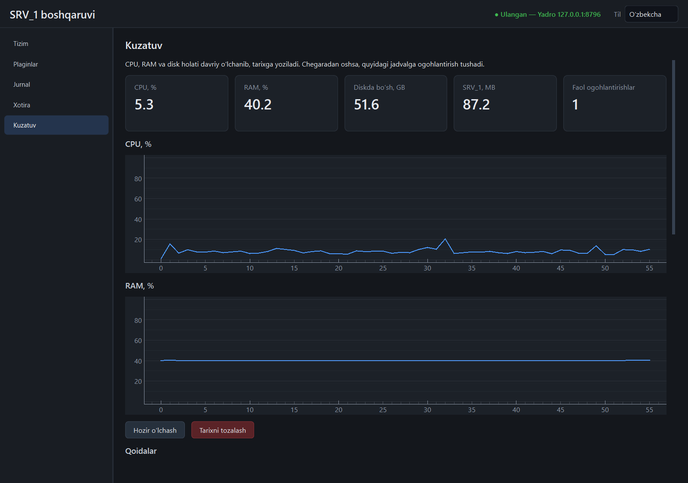

# `monitor` plagini («Kuzatuv»)

CPU, RAM va disk holatini davriy o'lchab, tarixga yozadi; chegaradan oshsa
ogohlantiradi. Yadro ichida ishlaydi, hech narsani boshqarmaydi — faqat o'qiydi
va o'z papkasiga yozadi.

Panelning pastki qismida **tarmoq kuzatuvi** bor: paketlarni ushlash, tahlil va xavf
tekshiruvlari. U alohida jarayonda, faqat so'ralganda ishlaydi va alohida hujjatda
tasvirlangan: [tarmoq-kuzatuvi.md](tarmoq-kuzatuvi.md). Quyidagilar — tizim holati haqida.



(Skrinshot uchun o'lchov oralig'i 1 soniya, disk chegarasi esa ataylab baland
qo'yilgan — shuning uchun bitta faol ogohlantirish ko'rinadi.)

## Nima o'lchanadi

Har `interval_s` (standart 15) soniyada va plagin yoqilganda darhol:

| Qiymat | Manba |
|--------|-------|
| CPU, % | butun mashina, oldingi o'lchovdan beri o'rtacha |
| RAM, % va band GB | butun mashina |
| Har qattiq diskda bo'sh joy | tarmoq va olinadigan disklar o'lchanmaydi (so'rovni osib qo'yishi mumkin) |
| SRV_1, MB | yadro va uning barcha bola jarayonlari (Caddy va uning `conhost.exe` si, loyihalar, og'ir plaginlar). **Shell kirmaydi** — u alohida dastur |

O'lchovlar `<ma'lumotlar>/plugins/monitor/data/monitor.db` (SQLite) ga yoziladi.
`retention_days` (standart 7) dan eskilari soatiga bir marta o'chiriladi.

## Ogohlantirishlar

| Qoida | Standart | Qachon chiqadi | Qachon yopiladi |
|-------|----------|----------------|-----------------|
| `memory` | 90 % | RAM bandligi chegaraga yetsa | chegaradan 5 foiz-band pastga tushsa |
| `cpu` | 90 %, 5 daqiqa | CPU shuncha vaqt uzluksiz chegaradan past tushmasa | chegaradan 5 foiz-band pastga tushsa |
| `disk:<disk>` | 10 GB | diskda bo'sh joy chegaradan kam bo'lsa | bo'sh joy chegaradan 10 % ko'p bo'lsa |
| `plugin:<nom>` | — | boshqa plagin yiqilsa yoki ishga tushmasa | u qayta ishga tushsa yoki o'chirilsa |

- Har qoida ikki holatli: chiqqanda bitta `raised`, yopilganda bitta `cleared`
  yozuvi. Faol turganda takror yozuv bo'lmaydi; yopilish chegarasi sal uzoqroq
  bo'lgani uchun chegara atrofidagi tebranish jadvalni to'ldirmaydi.
- Chegara `0` — qoida o'chirilgan; o'chirilganda faol ogohlantirishi yopiladi.
- Faol holatlar qayta ishga tushganda bazadan tiklanadi.
- Ogohlantirish — bu **hodisa va jadvaldagi yozuv**: `plugin.monitor.alert`
  hodisasi (shell'ning «Jurnal» sahifasida ham ko'rinadi) va yadro jurnalidagi
  `monitor_alert` satri.
- Har ko'tarilish va tinchlanishda **Windows bildirishnomasi** ham chiqadi
  (`ctx.notify` → `plugin.monitor.notify`), masalan «SRV_1 · monitor: Xotira
  chegaradan oshdi — Hozir 92,3 %, chegara 90 %». Uni ochiq turgan shell ko'rsatadi
  (tizim tepsisidagi SRV_1 belgisi orqali); bosilsa, SRV_1 oynasi oldinga chiqadi.
  Tovush va email yo'q.
- Oxirgi 1000 ta yozuv saqlanadi.

Chegaralar panelda o'zgartiriladi («Chegaralarni o'zgartirish»: bo'sh maydon
o'zgarmaydi) va darhol kuchga kiradi — keyingi o'lchovda.

## Sozlama

`<ma'lumotlar>/plugins/monitor/data/monitor.json`:

```json
{
  "config": {
    "interval_s": 15,
    "retention_days": 7,
    "thresholds": {"memory_percent": 90, "cpu_percent": 90, "cpu_minutes": 5, "disk_free_gb": 10}
  }
}
```

`interval_s` va `retention_days` faqat shu faylda; o'zgartirgach plaginni
o'chirib-yoqing. Fayl buzuq bo'lsa plagin ishga tushmaydi (jim standartga
qaytmaydi).

## API

Hammasi `/api/v1/plugins/monitor/api` ostida.

| Yo'l | Vazifa |
|------|--------|
| `GET /status` | oxirgi o'lchov, faol ogohlantirishlar soni, tarixdagi o'lchovlar soni va baza hajmi |
| `POST /sample` | hozir o'lchash (jadvalni kutmasdan) |
| `GET /history?minutes=60&limit=240` | o'lchovlar, eskidan yangiga: `ts`, `cpu`, `memory`, `srv1_mb` |
| `DELETE /history` | butun tarix va ogohlantirishlarni o'chiradi; auditga yoziladi |
| `GET /disks` | har disk: `free`, `total`, `used_percent` |
| `GET /rules` | har qoida: hozirgi qiymat, chegara, holat (`ok`, `alert`, `off`) |
| `GET /thresholds`, `POST /thresholds` | chegaralar; `POST` da faqat berilgan maydonlar o'zgaradi |
| `GET /alerts?limit=200` | ogohlantirishlar, yangidan eskiga |

Hodisalar: `plugin.monitor.sample` `{ts, cpu, memory, srv1_mb}`,
`plugin.monitor.alert` `{ts, key, state, value, limit, note}`.

Audit (`actor = plugin:monitor`): `monitor.history_clear`.

## Cheklovlar

- Jadvallarda qoida nomi va holat tarjimasiz (`memory`, `raised`, `alert`);
  qoidalar jadvalidagi sonlar nuqta bilan yoziladi.
- Grafikning gorizontal o'qi — o'lchov tartib raqami, vaqt emas.
- Shell yopiq bo'lsa, bildirishnoma chiqmaydi (yadro xizmat sifatida ekransiz
  sessiyada ishlaydi): ogohlantirish faqat jurnal va bazada qoladi.
- Bildirishnomaning ekranda ko'rinishi avtomatik sinalmagan: testlar hodisa va
  matnni tekshiradi; haqiqiy ish stolida `showMessage` chaqiruvi xatosiz o'tgani
  bir marta tekshirilgan. Windows «Diqqatni jamlash» rejimi uni yashirishi mumkin.
- Tarixda faqat umumiy qiymatlar: alohida jarayonlar bo'yicha tarix yo'q
  (jonli ro'yxat — `itops` da). Disklar tarixi yoziladi, lekin API orqali
  faqat oxirgi holati ko'rinadi.
- Grafik oxirgi 240 o'lchovni ko'rsatadi (standart oraliqda bir soat); uzoqroq
  davr uchun `GET /history`.
- CPU qoidasi o'lchovlar oralig'idagi o'rtachaga qaraydi: oraliqdan qisqa
  cho'qqilar ko'rinmaydi.
- Plagin o'chirilgan paytda o'lchov yozilmaydi — tarixda bo'shliq qoladi.
- Soat orqaga surilsa, tarix tartibi va saqlash muddati buziladi (vaqt
  belgisi sifatida devor soati ishlatiladi).
