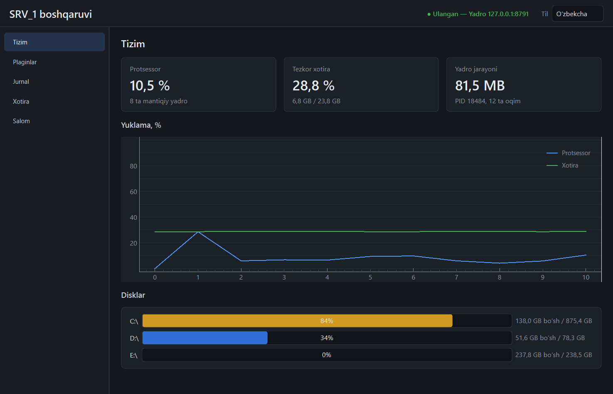
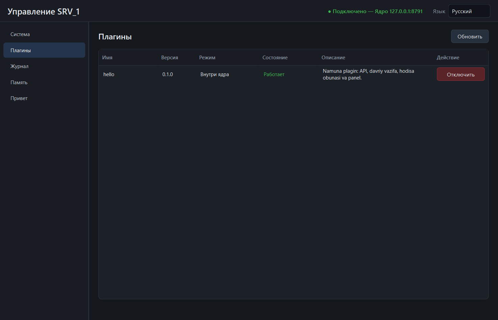
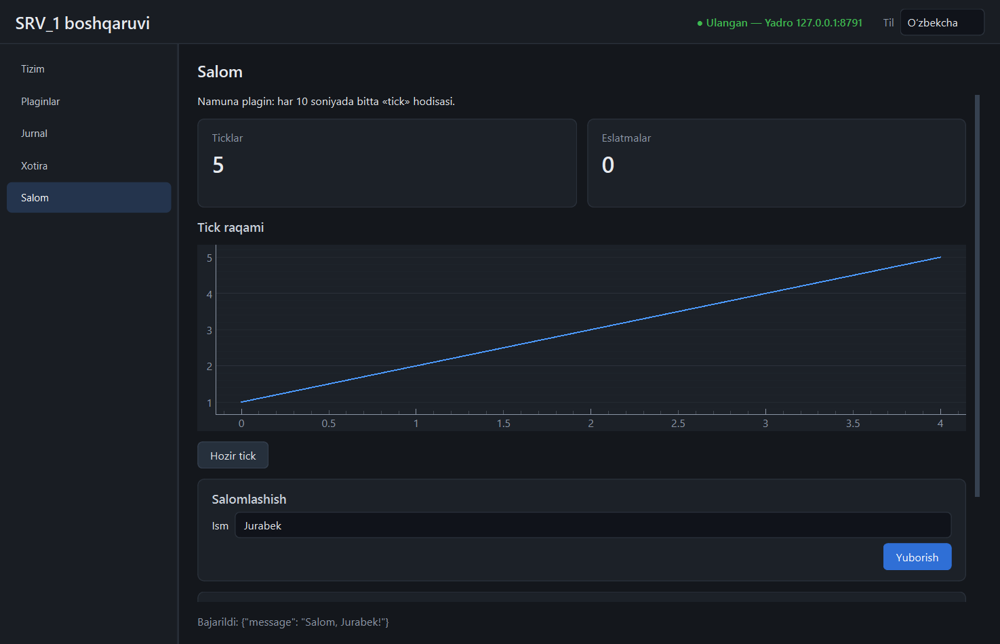
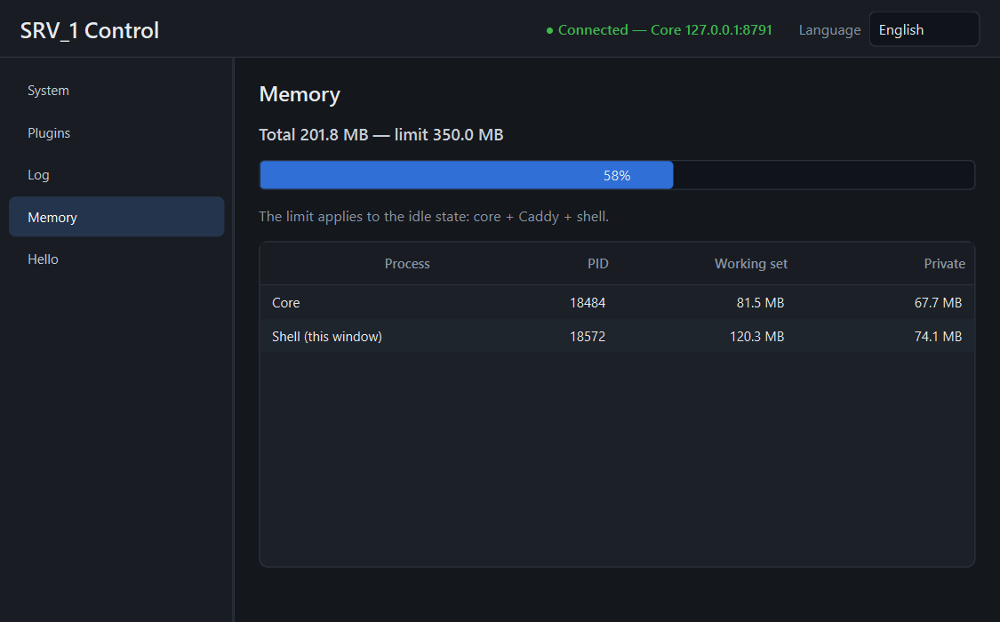

# Shell (`srv1_shell`)

PyQt6 klient. Biznes-mantiq yo'q: hamma ma'lumot yadro API'sidan keladi, hamma
amal yadro API'siga boradi.



## Ishga tushirish

Avval yadro ishlab turgan bo'lsin, so'ng:

```powershell
uv run python -m srv1_shell
```

Token `SRV1_DATA_DIR` (yoki `%PROGRAMDATA%\SRV_1`) ichidagi `auth.token` dan
o'qiladi. Fayl topilmasa, tokenni qo'lda kiritish oynasi chiqadi (saqlanmaydi).

Sozlamalar `%APPDATA%\SRV_1\shell.json` da (`SRV1_SHELL_CONFIG` bilan
o'zgartiriladi): `language`, `host`, `port`. Token u yerga yozilmaydi.

## Tillar

O'zbekcha, ruscha, inglizcha. Yuqori o'ng burchakdagi ro'yxatdan
almashtiriladi; tanlov eslab qolinadi.

- Matnlar: `shell/srv1_shell/translations.py` — har kalit uchun uch til.
  Testlar tekshiradi: har kalit uch tilda bor, o'rinbosarlar (`{name}`) bir
  xil, kodda so'ralgan har kalit jadvalda mavjud.
- Sonlar: o'zbekcha va ruschada kasr vergul bilan (`81,3 MB`), inglizchada
  nuqta bilan.
- Plagin panellari: plagin `{"uz": ..., "ru": ..., "en": ...}` bersa, shell
  joriy tilni tanlaydi.



## Sahifalar

| Sahifa | Nima ko'rsatadi | Manba |
|--------|-----------------|-------|
| Tizim | CPU, RAM, yadro jarayoni, disklar, yuklama grafigi | `/system` + `system.stats` |
| Plaginlar | ro'yxat, holat, xato matni, yoqish/o'chirish | `/plugins` + `plugins.state` |
| Jurnal | oxirgi 200 yozuv + jonli oqim; daraja filtri, pauza, tozalash | `/logs` + `log` |
| Xotira | har jarayon bo'yicha RAM, 350 MB chegarasiga nisbatan jami | `/system/processes` |
| *plagin nomi* | plagin paneli | `/plugins/{nom}/panel` |

Sahifa birinchi ochilganda quriladi va faqat ko'rinib turganda so'rov
yuboradi. Plagin yoqilsa, uning paneli chap ro'yxatda paydo bo'ladi;
o'chirilsa, yo'qoladi.

Xotira sahifasidagi «Shell» qatori shellning o'zida o'lchanadi (yadro uni
bilmaydi); qolgan qatorlar yadrodan keladi.



## Panel chizuvchi

`pages/panel_page.py` `PanelSpec` dagi olti vidjet turini chizadi:

| Vidjet | Qt ko'rinishi | Xatti-harakat |
|--------|---------------|---------------|
| `label` | matn | — |
| `value` | kartochka | `source` dan `refresh_s` da yangilanadi |
| `button` | tugma | `confirm` bo'lsa avval so'raydi; so'ng so'rov |
| `form` | maydonlar + «Yuborish» | `GET` — so'rov parametrlari, boshqasi — JSON |
| `table` | jadval | `source` dagi ro'yxat; ixtiyoriy filtrlar va tanlangan qator amallari |
| `chart` | chiziqli grafik | `plugin.<nom>.<topic>` hodisalari |

Bir xil `source` ga qaragan vidjetlar bitta so'rovni bo'lishadi. Har
muvaffaqiyatli amaldan keyin barcha manbalar darhol yangilanadi. Majburiy
maydon bo'sh yoki son maydonida matn bo'lsa, so'rov yuborilmaydi.

## Tuzilma

| Fayl | Vazifa |
|------|--------|
| `app.py` | `QApplication`, uslub, shrift, token |
| `main_window.py` | oyna, bo'limlar ro'yxati, til, panellarni sinxronlash |
| `api.py` | `httpx` fon oqimida; javob GUI oqimiga signal bilan qaytadi |
| `events.py` | `QWebSocket`; uzilsa 2 s da qayta ulanadi |
| `i18n.py`, `translations.py` | tarjima, son va hajm formatlash |
| `charts.py` | `pyqtgraph` o'rami |
| `theme.qss` | yagona uslub fayli |

## Uslub qoidalari

- `theme.qss` da `QWidget { background }` yozilmaydi (har ichki vidjetga meros
  bo'lib, to'q «qutilar» beradi) — test tekshiradi.
- Shrift QSS orqali emas, `QFont.setFamilies()` bilan beriladi.
- Rang darajasi (`ok`/`warn`/`bad`) dinamik xususiyat orqali; 75 % dan sariq,
  90 % dan qizil.

## Xotira

Shell `numpy` ni faqat `pyqtgraph` uchun yuklaydi. `srv1_shell/__init__.py`
BLAS oqimlarini bittaga cheklaydi (`OPENBLAS_NUM_THREADS=1`), aks holda 8
yadroli mashinada xususiy xotira 230 MB ga oshadi. O'lchovlar:
[bosqichlar.md](bosqichlar.md).


