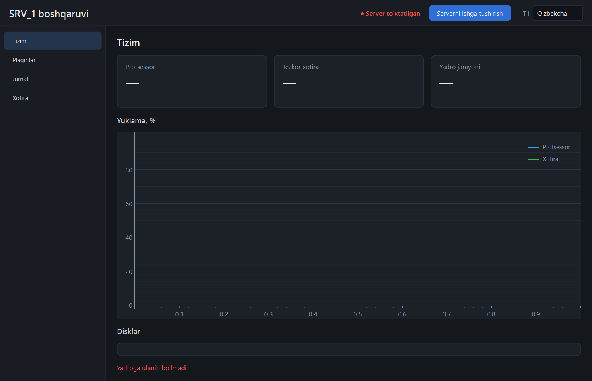

# Shell (`srv1_shell`)

PyQt6 klient. Biznes-mantiq yo'q: hamma ma'lumot yadro API'sidan keladi, hamma
amal yadro API'siga boradi.


## Ishga tushirish

```powershell
uv run python -m srv1_shell
```

Yadro ishlamayotgan bo'lsa, shell uni o'zi ko'taradi (pastdagi «Server» bo'limi). Token
`SRV1_DATA_DIR` (yoki `%PROGRAMDATA%\SRV_1`) ichidagi `auth.token` dan o'qiladi — yadro
birinchi marta ishga tushganda yaratadi, shell uni kutib oladi. Yadro ishlab turib, token
faylini o'qib bo'lmasagina (masalan, yadro boshqa hisob nomidan ishlayapti) tokenni qo'lda
kiritish oynasi chiqadi (saqlanmaydi).

Sozlamalar `%APPDATA%\SRV_1\shell.json` da (`SRV1_SHELL_CONFIG` bilan
o'zgartiriladi): `language`, `host`, `port`. Token u yerga yozilmaydi.

Oyna va yorliq belgisi (server shkafi) kodda chiziladi:
`shell/srv1_shell/icon.py`; `srv1.ico` — `uv run python -m srv1_shell.icon`.
O'rnatilgan tizimda shell «SRV_1» yorlig'idan ochiladi ([ornatish.md](ornatish.md)).

## Tillar

O'zbekcha, ruscha, inglizcha. Yuqori o'ng burchakdagi ro'yxatdan
almashtiriladi; tanlov eslab qolinadi.

- Matnlar: `shell/srv1_shell/translations.py` — har kalit uchun uch til.
  Testlar tekshiradi: har kalit uch tilda bor, o'rinbosarlar (`{name}`) bir
  xil, kodda so'ralgan har kalit jadvalda mavjud.
- Sonlar: o'zbekcha va ruschada kasr vergul bilan (`81,3 MB`), inglizchada
  nuqta bilan.
- Plagin panellari: plagin `{"uz": ..., "ru": ..., "en": ...}` bersa, shell
  joriy tilni tanlaydi.


## Sahifalar

| Sahifa | Nima ko'rsatadi | Manba |
|--------|-----------------|-------|
| Tizim | CPU, RAM, yadro jarayoni, disklar, yuklama grafigi | `/system` + `system.stats` |
| Plaginlar | ro'yxat, holat, xato matni, yoqish/o'chirish | `/plugins` + `plugins.state` |
| Jurnal | oxirgi 200 yozuv + jonli oqim; daraja filtri, pauza, tozalash | `/logs` + `log` |
| Xotira | har jarayon bo'yicha RAM, 350 MB chegarasiga nisbatan jami | `/system/processes` |
| *plagin nomi* | plagin paneli | `/plugins/{nom}/panel` |

Sahifa birinchi ochilganda quriladi va faqat ko'rinib turganda so'rov
yuboradi. Plagin yoqilsa, uning paneli chap ro'yxatda paydo bo'ladi;
o'chirilsa, yo'qoladi.

Xotira sahifasidagi «Shell» qatori shellning o'zida o'lchanadi (yadro uni
bilmaydi); qolgan qatorlar yadrodan keladi.


## Panel chizuvchi

`pages/panel_page.py` `PanelSpec` dagi sakkiz vidjet turini chizadi:

| Vidjet | Qt ko'rinishi | Xatti-harakat |
|--------|---------------|---------------|
| `label` | matn | — |
| `value` | kartochka | `source` dan `refresh_s` da yangilanadi |
| `button` | tugma | `confirm` bo'lsa avval so'raydi; so'ng so'rov |
| `form` | maydonlar + «Yuborish» | `GET` — so'rov parametrlari, boshqasi — JSON; `confirm` bo'lsa tugma qizil va tasdiq so'raladi |
| `table` | jadval | `source` dagi ro'yxat; ixtiyoriy filtrlar va tanlangan qator amallari |
| `chart` | chiziqli grafik | `plugin.<nom>.<topic>` hodisalari; `history` bo'lsa, sahifa har ochilganda saqlangan tarix qayta yuklanadi |
| `query` | matn maydoni + natija jadvali | ustunlar javobdan olinadi; Ctrl+Enter — bajarish; xato vidjetning o'zida |
| `log` | matn oynasi | `source` dagi satrlar; majburiy filtr bo'sh bo'lsa so'rov ketmaydi |

Bir xil `source` ga qaragan vidjetlar bitta so'rovni bo'lishadi. Har
muvaffaqiyatli amaldan keyin barcha manbalar darhol yangilanadi. Majburiy
maydon bo'sh yoki son maydonida matn bo'lsa, so'rov yuborilmaydi.

## Server: yadroni ishga tushirish va to'xtatish

Sarlavhada ulanish holati yonida bitta tugma bor: «Serverni to'xtatish» yoki «Serverni
ishga tushirish».

| Holat | Nima bo'ladi |
|-------|--------------|
| oyna ochildi, yadro javob beryapti | ulanadi, boshqa hech narsa qilmaydi |
| oyna ochildi, yadro yo'q, xizmat o'rnatilmagan | yadroni **oynasiz** ishga tushiradi (`python.exe -m srv1_core --no-console`), 90 s gacha kutadi, tokenni o'qib ulanadi |
| oyna ochildi, yadro yo'q, `SRV_1` xizmati o'rnatilgan, lekin to'xtatilgan | hech narsani ishga tushirmaydi (UAC so'ramaydi), sariq satrda tushuntiradi; tugma bosilsa — `sc start SRV_1` administrator tasdig'i bilan |
| «Serverni to'xtatish» | tasdiq so'raydi → `POST /system/shutdown` → yadro **jarayoni tugaguncha** kutadi (45 s gacha). Yadro xizmat ostida bo'lsa — `sc stop SRV_1` (UAC) |
| oyna yopildi | yadro ishlashda davom etadi |
| yadro o'zi o'ldi yoki tashqaridan to'xtatildi | holat «Server to'xtatilgan», sariq satrda jurnallar papkasi; tugma bilan qayta yoqiladi |
| yadro tashqaridan ko'tarildi (konsol, xizmat) | hodisalar oqimi 2 s da qayta ulanadi, holat o'zi to'g'rilanadi |



Ishga tushmasa, sabab oynaning o'zida, sarlavha ostidagi sariq satrda chiqadi (matnni
belgilab nusxalasa bo'ladi): yadroning oxirgi xabari va jurnallar papkasi
(`logs\core-launch.log` — ishga tushish paytidagi chiqish, `logs\srv1.log` — asosiy jurnal).

Tuzilishi: `launcher.py` — Qt'siz, bloklovchi funksiyalar (tekshirish, ishga tushirish,
to'xtatish, xizmat holati); `server_control.py` — ularni fon oqimida yuritib, natijani
signal bilan beradi; `main_window.py` faqat ko'rsatadi. Bu biznes-mantiq emas — yadro
jarayonining hayot sikli; to'xtatishning o'zi yadro API'si orqali.

Cheklovlar:

- Shell yadroni `shell.json` dagi manzilda kutadi (standart `127.0.0.1:8710`). Yadroning
  `config.toml` da boshqa port turgan bo'lsa, yadro ko'tariladi, lekin shell uni ko'rmaydi
  va 90 s dan keyin «javob bermadi» deydi — ikkala faylda port bir xil bo'lsin.
- Oynasiz ishga tushgan yadro foydalanuvchi seansiga tegishli: tizimdan chiqilsa to'xtaydi.
  Kompyuter yonishi bilan ishlashi kerak bo'lsa — Windows xizmati ([ornatish.md](ornatish.md)).
- Xizmat nomi standart `SRV_1`; `service.ps1 -Name` bilan boshqa nom berilgan bo'lsa,
  shell uchun `SRV1_SERVICE_NAME` muhit o'zgaruvchisida ko'rsatiladi.
- Xizmat `Running`, lekin yadro shell kutgan manzilda javob bermasa (masalan, port boshqa),
  shell alohida yadro ochmaydi: 90 s kutib, `service.log` yo'lini ko'rsatadi.
- Ikki oyna bir vaqtda ochilsa, ikkalasi ham yadroni ishga tushirishga urinishi mumkin:
  ikkinchi yadro portni band ko'rib darhol chiqadi (kod 3), ikkala oyna ham birinchisiga ulanadi.

## Tuzilma

| Fayl | Vazifa |
|------|--------|
| `app.py` | `QApplication`, uslub, shrift, yadroni ko'tarish, token |
| `main_window.py` | oyna, bo'limlar ro'yxati, server tugmasi, til, panellarni sinxronlash |
| `launcher.py` | yadro jarayoni: tekshirish, oynasiz ishga tushirish, to'xtatish (Qt'siz) |
| `server_control.py` | `launcher` amallari fon oqimida, holat signallari |
| `api.py` | `httpx` fon oqimida; javob GUI oqimiga signal bilan qaytadi |
| `events.py` | `QWebSocket`; uzilsa 2 s da qayta ulanadi |
| `i18n.py`, `translations.py` | tarjima, son va hajm formatlash |
| `charts.py` | `pyqtgraph` o'rami |
| `theme.qss` | yagona uslub fayli |

## Uslub qoidalari

- `theme.qss` da `QWidget { background }` yozilmaydi (har ichki vidjetga meros
  bo'lib, to'q «qutilar» beradi) — test tekshiradi.
- Shrift QSS orqali emas, `QFont.setFamilies()` bilan beriladi.
- Rang darajasi (`ok`/`warn`/`bad`) dinamik xususiyat orqali; 75 % dan sariq,
  90 % dan qizil.

Oyna sarlavhasi ham to'q (Windows 10 2004 va undan yangi; eskisida tizimniki qoladi).

## Bildirishnomalar

Shell ochiq turganda tizim tepsisida SRV_1 belgisi turadi. Plagin `ctx.notify` chaqirsa
(`plugin.<nom>.notify` hodisasi), shell uni Windows bildirishnomasi qilib ko'rsatadi:
sarlavha `SRV_1 · <plagin>: <sarlavha>`, joriy tilda. Aynan bir xil xabar 30 s ichida
takror ko'rsatilmaydi. Belgi yoki bildirishnoma bosilsa, oyna oldinga chiqadi. Qachon
va nima haqida xabar berishni plagin hal qiladi — shell'da bu haqda mantiq yo'q
(`srv1_shell/notifier.py`).

## Xotira

Shell `numpy` ni faqat `pyqtgraph` uchun yuklaydi. `srv1_shell/__init__.py`
BLAS oqimlarini bittaga cheklaydi (`OPENBLAS_NUM_THREADS=1`), aks holda 8
yadroli mashinada xususiy xotira 230 MB ga oshadi. O'lchovlar:
[bosqichlar.md](bosqichlar.md).


