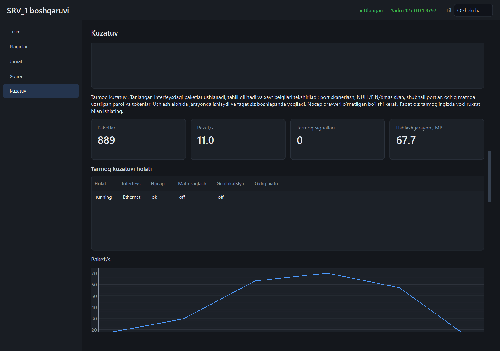

# Tarmoq kuzatuvi (`monitor` plagini, «Kuzatuv» → «Tarmoq»)

Tanlangan tarmoq interfeysidagi paketlarni ushlaydi, tahlil qiladi va xavf belgilarini
tekshiradi. `netmonitor_new_v3_9.py` skriptining qayta yozilgan ko'rinishi: konsol o'rniga
API va panel, JSON fayllar o'rniga SQLite, bitta oqim o'rniga alohida jarayon.



**Faqat o'z tarmog'ingizda yoki ruxsat bilan ishlating.** Ushlashni boshlash va to'xtatish
audit jurnaliga yoziladi.

## Nima kerak

- **Npcap** drayveri (<https://npcap.com/#download>). O'rnatuvchiga kirmaydi — litsenziyasi
  ruxsat bermaydi. Yo'q bo'lsa, bo'lim «Npcap o'rnatilmagan» deb javob beradi; `monitor`
  ning qolgan qismi ishlayveradi.
- Npcap «faqat administratorlar uchun» rejimida o'rnatilgan bo'lsa, yadro administrator
  nomidan ishlashi kerak (standart o'rnatishda bu shart emas).

## Qanday ishlaydi

```
monitor plagini (yadro ichida)                 ushlash ishchisi (alohida jarayon)
  NetService ── ctx.spawn, RAM limiti ───────▶   python -m netcap.worker
     ▲   │  stdin: pause / resume / exclude / stop   scapy + Npcap → tahlil → tekshiruv
     │   └───────────────────────────────────────▶
     └──── stdout: har soniyada bitta JSON (tick) ◀──
  netcap.db (SQLite), hodisalar, bildirishnoma
```

- Ishchi **faqat siz boshlaganda** ishga tushadi va to'xtatilganda yo'qoladi. scapy faqat
  unda yuklanadi; yadro qayta ishga tushganda ushlash o'zi davom etmaydi.
- Ishchi Job Object ichida: `worker_memory_mb` (standart 200 MB) dan oshsa yoki yadro
  o'lsa — u ham to'xtaydi.
- Har paket tekshiriladi va sanaladi, lekin jadvalga soniyasiga ko'pi bilan 200 tasi
  tushadi (belgilangan paketlar — har doim). Qolgani `skipped` hisoblagichida.
- Bazada oxirgi `max_packets` (standart 20 000) paket va 2 000 signal saqlanadi.

## Xavf tekshiruvlari

| Tur (`kind`) | Qachon chiqadi |
|--------------|----------------|
| `port_scan` | bitta manbadan bitta manzilga 10 s ichida 15 ta turli portga **yangi ulanish urinishi** (TCP SYN, ACK'siz) |
| `null_scan`, `fin_scan`, `xmas_scan` | TCP bayroqlari mos ravishda bo'sh, faqat `F`, `FPU` |
| `port` | shubhali **manzil** portiga yangi murojaat (TCP SYN yoki UDP); standart ro'yxat: 23, 4444, 5555, 6667, 31337 |
| `secret` | shifrlanmagan paketda `nom = qiymat` ko'rinishidagi parol/token (`password`, `pwd`, `secret`, `token`, `api_key`, `access_key`), `Authorization:` sarlavhasi yoki FTP/POP3 `PASS` buyrug'i |

- Bir xil signal (tur, manba, manzil) 60 s ichida takrorlanmaydi; bostirilganlari
  `suppressed` da sanaladi.
- Signal jurnalga (`netcap_alert`), `plugin.monitor.net_alert` hodisasiga va Windows
  bildirishnomasiga chiqadi (bildirishnoma — 10 s da ko'pi bilan bitta).
- `secret` signali va paketdagi «Belgi» ustuni sirning **turini** ko'rsatadi, qiymatini emas.

## Maxfiylik

- **Paket matni standart holatda hech qayerga yozilmaydi.** «Paket matnini saqlash»
  yoqilsa, har paketning dastlabki 256 belgisi bazaga tushadi (ichida ochiq uzatilgan
  parol bo'lishi mumkin); yoqilgani auditga yoziladi (`net.payload_store`).
- **Geolokatsiya standart holatda o'chiq.** Yoqilsa, eng faol tashqi IP manzillar
  `ip-api.com` ga yuboriladi. Bepul xizmat faqat HTTP orqali ishlaydi — so'ralgan
  manzillar tarmoqda ochiq ko'rinadi. Xususiy, multicast va kuzatuvdan chiqarilgan
  manzillar so'ralmaydi; natija (muvaffaqiyatsizi ham) keshlanadi, so'rovlar orasi 1,6 s.
- Baza va sozlama ma'lumotlar papkasida (`plugins\monitor\data\`), u faqat sizga, SYSTEM
  va administratorlarga ochiq.

## Sozlama

`<ma'lumotlar>/plugins/monitor/data/netcap.json` (paneldagi forma shuni o'zgartiradi):

| Maydon | Standart | Izoh |
|--------|----------|------|
| `bpf_filter` | `""` | ushlash filtri, masalan `tcp port 80` yoki `not host 10.0.0.5` |
| `store_payload` | `false` | paket matnining boshini saqlash |
| `geo` | `false` | tashqi manzillar qayerdaligini so'rash |
| `excluded` | `[]` | kuzatuvdan chiqarilgan IPv4/IPv6 manzillar (500 tagacha) |
| `suspicious_ports` | 23, 4444, 5555, 6667, 31337 | |
| `scan_ports`, `scan_window_s` | 15, 10 | port skan chegarasi |
| `max_packets` | 20 000 | bazadagi paket yozuvlari |
| `worker_memory_mb` | 200 | ishchi jarayon RAM limiti |

Ushlash ishlab turganda sozlama o'zgarsa, ishchi yangi sozlama bilan qayta boshlanadi
(1–2 s). Chiqarilgan manzillar va pauza — qayta boshlamasdan, darhol.

## API

`/api/v1/plugins/monitor/api/net` ostida:

| Yo'l | Vazifa |
|------|--------|
| `GET /status` | holat (`stopped`, `starting`, `running`, `paused`, `error`), hisoblagichlar, ishchi xotirasi, oxirgi xato |
| `GET /summary` | bitta qator: holat, interfeys, Npcap bor-yo'qligi, oxirgi xato (panel jadvali uchun) |
| `GET /interfaces` | yoqilgan interfeyslar |
| `POST /start {name}` | ushlashni boshlaydi; ishchi tayyor bo'lguncha kutadi (xato bo'lsa sababini qaytaradi) |
| `POST /stop`, `/pause`, `/resume` | |
| `GET /packets?limit=&ip=&proto=` | oxirgi paketlar, yangidan eskiga |
| `GET /alerts?limit=` | xavf signallari |
| `GET /hosts` | eng ko'p trafikli 20 manzil (joriy ushlash davomida) |
| `GET /excluded`, `POST /exclude {ips}`, `POST /unexclude {ip}` | kuzatuvdan chiqarilgan manzillar |
| `GET /settings`, `POST /settings` | sozlama; faqat berilgan maydonlar o'zgaradi |
| `DELETE /data` | saqlangan paket va signallarni o'chiradi |

Hodisalar: `plugin.monitor.net` `{ts, pps, total}` (har soniyada), `plugin.monitor.net_alert`
`{ts, kind, src, dst, note}`. Audit: `process.spawn`, `net.capture_start`,
`net.capture_stop`, `net.payload_store`, `net.data_clear`.

## Asl skriptga nisbatan tuzatilganlar

| Asl skriptda | Endi |
|--------------|------|
| ikki oqim bir vaqtda `input()` o'qirdi (buyruq va interfeys raqami aralashardi) | konsol yo'q: API va panel |
| bitta buzuq paket yoki DNS tahlilidagi xato ushlashni to'xtatardi | xato sanaladi (`errors`, `last_error`), ushlash davom etadi; scapy 2.6+ dagi `qd` ro'yxati hisobga olingan |
| geolokatsiya ushlashni bloklardi, muvaffaqiyatsiz natija keshlanmasdi, `172.` ning hammasi xususiy sanalardi, chiqarilgan IP ham so'ralardi | alohida oqim, kesh, `ipaddress` bo'yicha aniq tekshiruv, standart holatda o'chiq |
| port skan detektori DNS javoblarini skan deb bilardi, oyna har paketda uzayardi | faqat SYN, manba–manzil juftligi bo'yicha, qat'iy oyna |
| «XAVFLI PAYLOAD» deyarli har HTTP so'rovda (`User-Agent`, `keep-alive`) | faqat `nom = qiymat`, `Authorization`, `PASS`; shifrlangan (TLS) paketlar tekshirilmaydi |
| parollar ochiq matnda JSON fayllarga yozilardi | matn standart holatda saqlanmaydi |
| har paketda `print`, fayl ochib-yopish | navbat, soniyada bitta tranzaksiya |
| kesh va hisoblagichlar cheksiz o'sardi | hammasi chegaralangan |
| signallar har paketda, cheklovsiz | 60 s sukut, bildirishnoma 10 s da bitta |
| IPv6, ARP ko'rinmasdi; ICMP porti bo'sh chiqardi | IPv4, IPv6, ARP, ICMP, ICMPv6 |
| chiqarilgan IP'lar qayta ishga tushganda yo'qolardi | `netcap.json` da saqlanadi |
| `SystemMonitor` bo'sh edi; type hint va test yo'q | o'lik kod yo'q; tiplar to'liq; 35 test |

## O'lchangan (2026-11-14, shu ishlab chiqish mashinasi)

Yadro faqat `monitor` plagini bilan, private xotira. Jadvalda birinchi o'lchov; ikkinchisi
(bo'sh 69,5 MB, ushlashda jami 119,9 MB, to'xtatilgach 70,1 MB) shunga yaqin chiqdi:

| Holat | Yadro | Ishchi | Jami |
|-------|-------|--------|------|
| bo'sh, eski `monitor` (0.1.0) | 69,3 MB | — | 69,3 MB |
| bo'sh, yangi `monitor` (0.2.0) | 69,7 MB | — | 69,7 MB |
| ushlash paytida (Ethernet, 20 s) | 69,9 MB | 44,1 MB + konsol xosti 6,3 MB | 120,3 MB |
| to'xtatilgach (5 s) | 72,4 MB | — | 72,4 MB |

Ya'ni bo'sh holatdagi 350 MB chegaraga ta'siri +0,4 MB; ushlash paytida +51 MB.
To'xtatilgach yadro boshlang'ich holatdan 1–3 MB ko'proq band qiladi (ombor va jarayon
boshqaruvi modullari yuklangani uchun) — bu qaytmaydi.

20 soniyada oddiy ish trafigida: 3 068 paket, xato 0, bazaga 1 642 tasi tushdi (qolgani —
soniyalik chegaradan oshgan paytlarda faqat sanalgan), baza 428 KB.

## Sinalgan va sinalmagan

Sinalgan: tahlil va tekshiruvlar sun'iy paketlar bilan; xizmatning to'liq sikli soxta
ishchi bilan (ikkala plagin rejimida); ishchi yiqilishi va Npcap yo'qligi; **haqiqiy
ushlash** — loopback interfeysida avtomatik test (yuborilgan `password=...` belgilanadi,
lekin matni na javobda, na baza faylida yo'q) va Ethernet'da qo'lda 20 s; panel surati
ko'zdan kechirildi.

**Sinalmagan:**

- katta yuk (soniyasiga minglab paket): scapy sekin, bunday oqimda paketlar drayver
  buferida yo'qolishi mumkin va bu sanalmaydi (faqat ishchigacha yetib kelganlar sanaladi);
- Npcap «faqat administratorlar» rejimi va Npcap'siz toza mashina (xabar chiqishi testda
  tekshirilgan, haqiqiy mashinada emas);
- geolokatsiyaning haqiqiy `ip-api.com` bilan ishlashi (faqat soxta javob bilan);
- Wi-Fi interfeysi, VPN va boshqa kompyuterlarning trafigi (oddiy kommutatorli tarmoqda
  faqat o'z mashinangiz va umumiy efir paketlari ko'rinadi);
- soatlab uzluksiz ushlash; haqiqiy port skaner (nmap) bilan detektorni sinash;
- yadro Windows xizmati sifatida ishlaganda ushlash.

## Cheklovlar

- Jadvallardagi holat va signal turlari tarjimasiz (`running`, `port_scan`).
- Holat va interfeys nomi kartochkada emas, jadvalda: uzun matn kartochkaga sig'maydi.
- «Eng faol manzillar» faqat joriy ushlash davriga tegishli va saqlanmaydi.
- Vaqt ustuni daqiqagacha ko'rsatiladi (umumiy jadval formati).
- Ishchi yiqilsa, o'zi qayta ko'tarilmaydi: holat `error` bo'ladi va bildirishnoma chiqadi.
- UDP skan va sekin (oynadan uzun) skanlar aniqlanmaydi.
