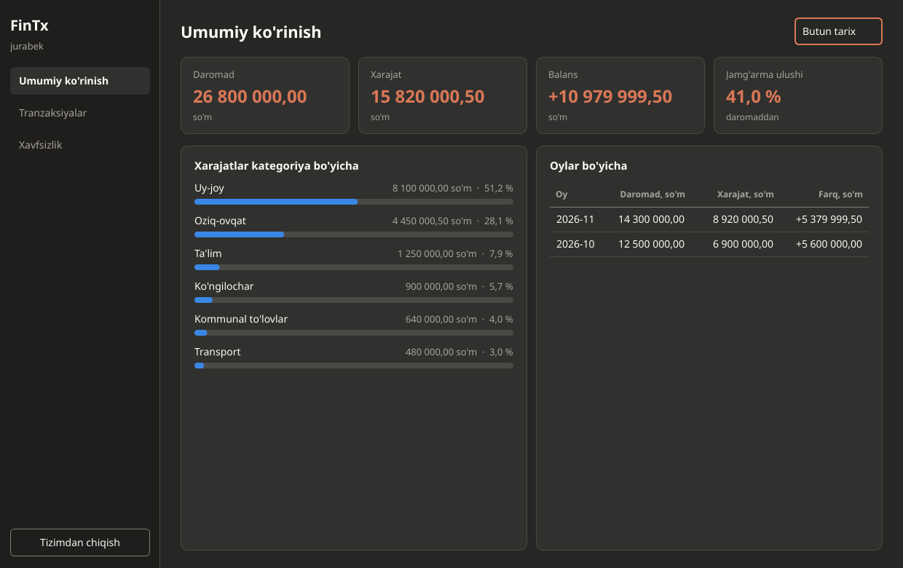
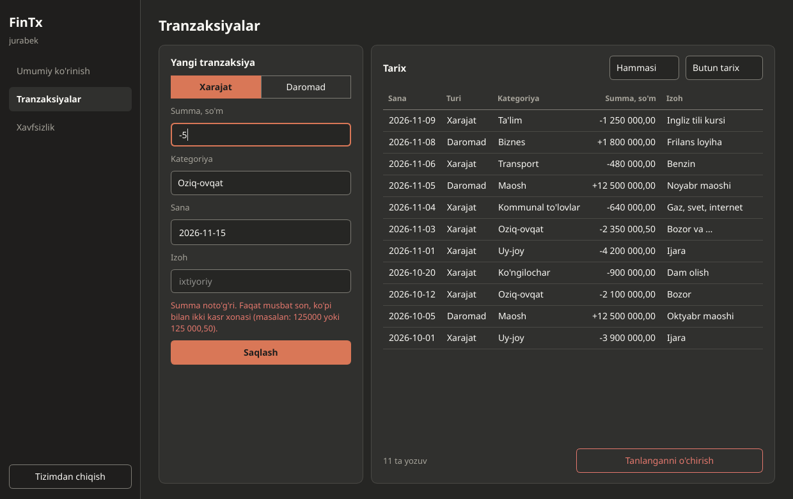

# FinTx — moliyaviy tranzaksiyalar prototipi

"FinMind Security-Aware Application Development" topshirig'i uchun kichik, lekin
xavfsizlik nuqtai nazaridan puxta o'ylangan prototip: foydalanuvchi ro'yxatdan
o'tadi, tizimga kiradi, daromad va xarajatlarini yozadi, tarixni ko'radi va
asosiy moliyaviy hisob-kitoblarni oladi.

Bitta yadro — ikkita interfeys:

| Interfeys | Qayerda | Buyruq | Talab |
|---|---|---|---|
| Desktop | macOS (Windows/Linux'da ham ishlaydi) | `python3 -m fintx.gui` | Python 3.10+, PySide6 |
| Terminal | Windows Terminal, PowerShell, cmd | `python -m fintx` | faqat Python 3.10+ |

Ikkala interfeys ham bir xil xizmat qatlamidan (`fintx/app.py`) foydalanadi,
shuning uchun tekshiruv va xavfsizlik qoidalari ikkalasida aynan bir xil.




## O'rnatish (tayyor paketlar)

Paketlar `.github/workflows/finmind-prototype-release.yml` orqali GitHub'ning macOS va
Windows runner'larida yig'iladi; ichida Python ham, barcha kutubxonalar ham bor —
foydalanuvchiga hech narsa o'rnatish kerak emas.

| Tizim | Fayl | O'rnatish |
|---|---|---|
| Windows 10/11 (x64) | `FinTx-<versiya>-Windows-Setup.exe` | Ishga tushiring → "Keyingi" → "O'rnatish". Administrator huquqi kerak emas. Boshlash menyusida **FinTx** (desktop) va **FinTx (terminal)** paydo bo'ladi. |
| macOS, Apple Silicon (M1+) | `FinTx-<versiya>-macOS-arm64.dmg` | Oching va **FinTx**'ni **Applications** papkasiga suring. |
| macOS, Intel | `FinTx-<versiya>-macOS-x86_64.dmg` | Xuddi shunday. |

Har bir fayl yonida `.sha256` nazorat yig'indisi bor. Dastur o'chirilganda
foydalanuvchi ma'lumotlari (baza fayli) o'chirilmaydi.

### Imzo holati — muhim

Hozirgi paketlar **ishonchli nashriyotchi imzosisiz**: buning uchun Apple va
Microsoft tan oladigan, pullik va shaxsni tasdiqlash orqali beriladigan
sertifikatlar kerak, ularni dastur kodi bilan "yasab" bo'lmaydi.

- **macOS:** ilova faqat ad-hoc imzolangan. Birinchi ishga tushirishda Gatekeeper
  to'sadi: *System Settings → Privacy & Security → "Open Anyway"* (eski
  versiyalarda: ilovaga o'ng tugma → *Open*).
- **Windows:** o'rnatuvchi imzolanmagan. SmartScreen "Windows protected your PC"
  deydi: *More info → Run anyway*.

Haqiqiy imzo uchun repozitoriyga quyidagi sirlarni (Settings → Secrets and
variables → Actions) qo'shish kifoya — workflow ularni ko'rsa, o'zi imzolaydi:

| Sir | Nima |
|---|---|
| `FINTX_MACOS_CERT_P12_B64`, `FINTX_MACOS_CERT_PASSWORD` | Apple Developer Program'dagi "Developer ID Application" sertifikati (`.p12`, base64) |
| `FINTX_APPLE_ID`, `FINTX_APPLE_TEAM_ID`, `FINTX_APPLE_APP_PASSWORD` | Notarizatsiya uchun Apple ID, jamoa ID'si va ilova paroli |
| `FINTX_WINDOWS_CERT_PFX_B64`, `FINTX_WINDOWS_CERT_PASSWORD` | Authenticode kod-imzolash sertifikati (`.pfx`, base64) |

Imzolash qadamlari sertifikat bo'lmagani uchun hali amalda sinalmagan. Yangi
Windows sertifikatlari odatda `.pfx` fayl emas, apparat token yoki bulutli HSM
ko'rinishida beriladi — unda Windows qadami o'sha provayderga moslanadi.

Reliz chiqarish: `fintx-v0.1.0` kabi teg qo'yilsa, workflow paketlarni yig'ib,
GitHub Release'ga biriktiradi.

## Manba koddan ishga tushirish

### Windows — terminal

Hech narsa o'rnatish shart emas (yadro faqat standart kutubxonada ishlaydi):

```bat
cd finmind_prototype
python -m fintx
```

yoki `run_cli.bat` ni ikki marta bosing. Parol terilayotganda ekranda ko'rinmaydi.

### macOS — desktop

```bash
cd finmind_prototype
python3 -m venv .venv
.venv/bin/python -m pip install -r requirements-gui.txt
.venv/bin/python -m fintx.gui
```

yoki Finder'da `run_desktop.command` ni ikki marta bosing — u birinchi marta
virtual muhitni o'zi tayyorlaydi. Python'ni [python.org](https://www.python.org/downloads/)
yoki Homebrew'dan o'rnating (Xcode bilan keladigan 3.9 yetarli emas).

### Testlar

```bash
python -m unittest discover -s tests -t .
```

99 ta test. PySide6 o'rnatilmagan bo'lsa, 10 ta desktop testi o'tkazib yuboriladi,
qolgani ishlayveradi. CI (`.github/workflows/finmind-prototype.yml`) testlarni
Ubuntu, macOS va Windows'da, Python 3.10 va 3.13 bilan ishga tushiradi.

## Talablar qayerda bajarilgan

| Talab | Kod | Testlar |
|---|---|---|
| Ro'yxatdan o'tish va autentifikatsiya | `fintx/auth.py` | `tests/test_auth.py` |
| Daromad va xarajatni yozish | `fintx/transactions.py` | `tests/test_transactions.py` |
| Tranzaksiyalar tarixi (filtr, sahifalash) | `fintx/transactions.py` | `tests/test_transactions.py` |
| Asosiy moliyaviy hisob-kitoblar | `fintx/reports.py` | `tests/test_reports.py` |
| Kirish ma'lumotlarini tekshirish | `fintx/validation.py`, `fintx/money.py` | `tests/test_validation.py` |
| Parollarni xavfsiz saqlash | `fintx/security.py` | `tests/test_security.py` |
| Avtomatik testlar | `tests/` | — |
| Terminal interfeysi | `fintx/cli.py` | `tests/test_cli.py` |
| Desktop interfeys | `fintx/gui/` | `tests/test_gui.py` |

Hisob-kitoblar: jami daromad, jami xarajat, balans, jamg'arma ulushi, o'rtacha va
eng katta xarajat, kategoriyalar bo'yicha ulushlar, oylar bo'yicha yig'ma.

## Xavfsizlik choralari

**Parollar**
- Bazada faqat tuzlangan xesh: scrypt, N=2¹⁷, r=8, p=1 (OWASP tavsiyasi), har bir
  parol uchun alohida 16 baytlik tasodifiy tuz. scrypt mavjud bo'lmagan muhitda —
  PBKDF2-HMAC-SHA256, 600 000 iteratsiya.
- Xesh satri o'z parametrlarini saqlaydi; parametrlar kuchaytirilsa, eski xesh
  keyingi muvaffaqiyatli kirishda avtomatik yangilanadi.
- Solishtirish doimiy vaqtda (`hmac.compare_digest`).
- Siyosat: kamida 12 belgi, ko'pi bilan 128; taniqli va bir xil belgili parollar
  hamda ichida login bo'lgan parol rad etiladi. "Katta harf + raqam + belgi"
  majburiyati ataylab yo'q (NIST SP 800-63B).
- Parol hech qachon buyruq argumenti sifatida olinmaydi, ekranga chiqmaydi,
  jurnalga yozilmaydi; desktopda parol maydonlari har urinishdan keyin tozalanadi.

**Kirish**
- Xato sababi aytilmaydi: "Login yoki parol noto'g'ri." Mavjud bo'lmagan login
  uchun ham bitta xesh tekshiruvi bajariladi — javob vaqti login bor-yo'qligini
  oshkor qilmaydi.
- Ketma-ket 5 ta xato → hisob 30 soniyaga qulflanadi; har keyingi xatoda muddat
  ikki baravar (ko'pi bilan 15 daqiqa). Qulf paytida parol umuman tekshirilmaydi.
- Sessiya faqat xotirada (diskda token yo'q), 15 daqiqa harakatsizlikdan keyin
  tugaydi; desktop bunda ekrandagi ma'lumotni ham tozalab, kirish oynasiga qaytadi.
- Xavfsizlik jurnali: kirish, xato urinish, qulflash, parol o'zgarishi.
  Tanilmagan login matni jurnalga yozilmaydi (odamlar login maydoniga adashib
  parolini terib yuboradi).

**Ma'lumotlar**
- Barcha SQL so'rovlari o'zgarmas matn va `?` parametrlari bilan; foydalanuvchi
  matni SQL satriga hech qachon qo'shilmaydi.
- Har bir so'rov `user_id` bilan cheklangan; begona tranzaksiyani o'chirishga
  urinish "topilmadi" bilan bir xil javob oladi.
- Sxemadagi CHECK va FOREIGN KEY cheklovlari xizmat qatlamidagi tekshiruvni
  takrorlaydi (ikkinchi himoya chizig'i).
- Baza fayli POSIX'da `0600` ruxsat bilan, foydalanuvchining shaxsiy papkasida
  yaratiladi; `secure_delete` yoqilgan.
- Pul tiyinda, butun sonlarda saqlanadi va hisoblanadi — `float` ishlatilmaydi.

**Kirish ma'lumotlarini tekshirish**
- Summa: faqat ASCII raqamlar, musbat, ko'pi bilan ikki kasr xonasi, yuqori
  chegara 1 trillion so'm; `-5`, `1e5`, `NaN`, `١٢٣` rad etiladi.
- Tur va kategoriya — yopiq ro'yxatdan; sana — `YYYY-MM-DD`, kelajakda emas.
- Izohda boshqaruv belgilari (masalan, terminal ESC ketma-ketliklari) rad etiladi,
  chiqarishda esa qo'shimcha ravishda zararsizlantiriladi.
- Desktopda bazadan o'qilgan matn hech qachon HTML sifatida talqin qilinmaydi.

**Xatolar**
- Foydalanuvchiga faqat tushunarli xabar; stack trace, SQL yoki fayl yo'li
  ko'rsatilmaydi.

## Tuzilishi

```
fintx/
  validation.py   kirish ma'lumotlarini tekshirish, parol siyosati
  money.py        summani tiyinga aylantirish va formatlash
  security.py     parol xeshlash (scrypt / PBKDF2)
  db.py           SQLite: fayl ruxsatlari, sxema, cheklovlar
  auth.py         ro'yxatdan o'tish, kirish, qulflash, sessiya, jurnal
  transactions.py daromad/xarajat, tarix, o'chirish
  reports.py      moliyaviy hisob-kitoblar (sof funksiyalar)
  app.py          xizmatlarni birlashtiruvchi yadro
  cli.py          terminal interfeysi
  gui/            desktop interfeys (PySide6)
  selftest.py     yig'ilgan paketni tekshirish (`--self-test`)
tests/            avtomatik testlar (unittest)
packaging/        PyInstaller spetsifikatsiyasi, Inno Setup skripti, belgi
```

Baza fayli: macOS — `~/Library/Application Support/FinTx/fintx.db`,
Windows — `%APPDATA%\FinTx\fintx.db`. Boshqa joy: `--db FAYL` yoki `FINTX_DB`.

## Prototipning cheklovlari

Bularni bilib qo'ygan ma'qul — ishlab chiqarishga chiqishdan oldin hal qilinadi:

- **Baza shifrlanmagan.** Parollar xeshlangan, lekin tranzaksiyalar diskda ochiq.
  Himoya — fayl ruxsatlari va disk shifrlash (FileVault/BitLocker); keyingi qadam —
  SQLCipher. Standart kutubxonada AES yo'q, o'zim kriptografiya yozmadim.
- **Mahalliy ilova.** Server, tarmoq va ko'p foydalanuvchili rejim yo'q; kompyuterga
  administrator sifatida kira oladigan odam baza faylini o'qiy oladi.
- **Qulflash tizim soatiga tayanadi**; soatni o'zgartira oladigan mahalliy
  foydalanuvchi kutish muddatini qisqartirishi mumkin.
- **Ikki bosqichli kirish va parolni tiklash yo'q.** Parol unutilsa, hisobni
  tiklab bo'lmaydi.
- **Parol xotirada** Python satri sifatida turadi va uni ishonchli nollab bo'lmaydi.
- **Paketlar ishonchli imzosiz** (yuqoridagi "Imzo holati" bo'limiga qarang).
- Desktop interfeys va paketlar avtomatik sinovdan o'tgan (CI: macOS va Windows
  runner'larida yig'ish, o'rnatish, ishga tushirish), lekin haqiqiy ekranda
  ko'z bilan tekshirilmagan.

## Litsenziyalar

Ilova ichidagi Noto Sans shrifti — SIL Open Font License 1.1
(`fintx/assets/fonts/OFL.txt`).
