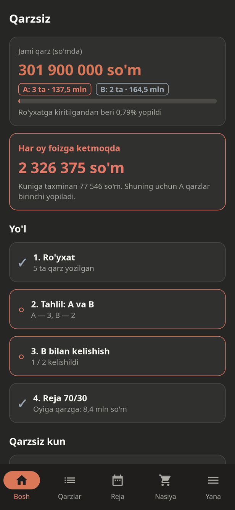
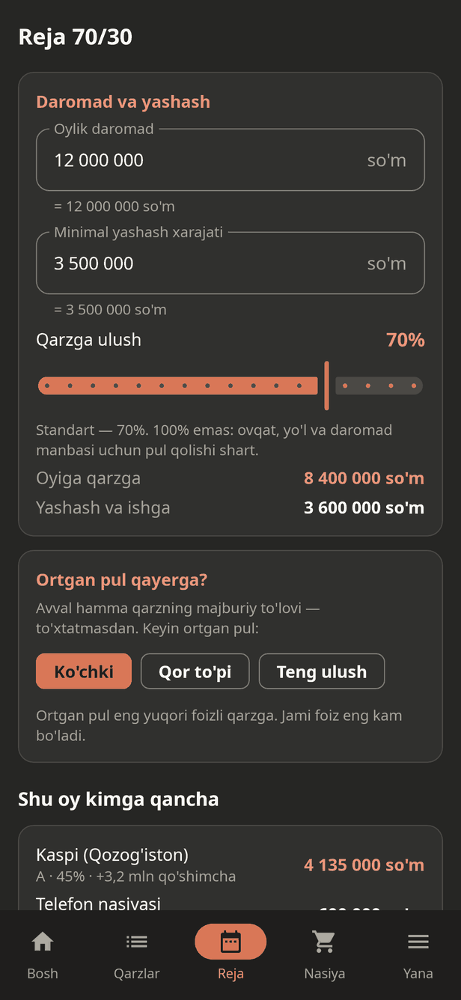
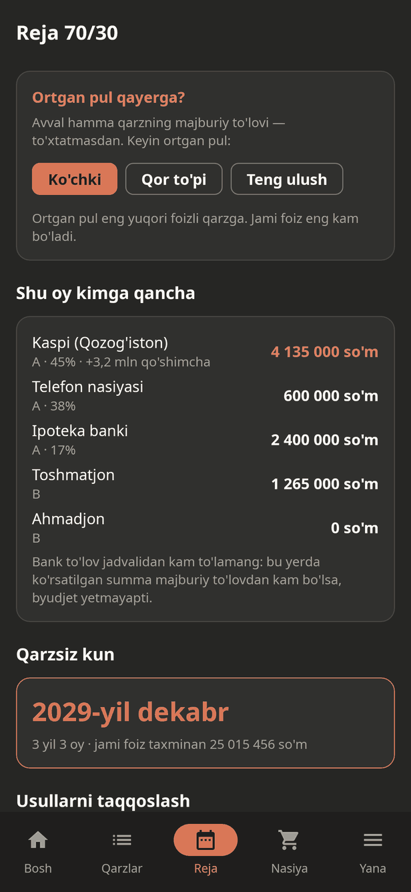
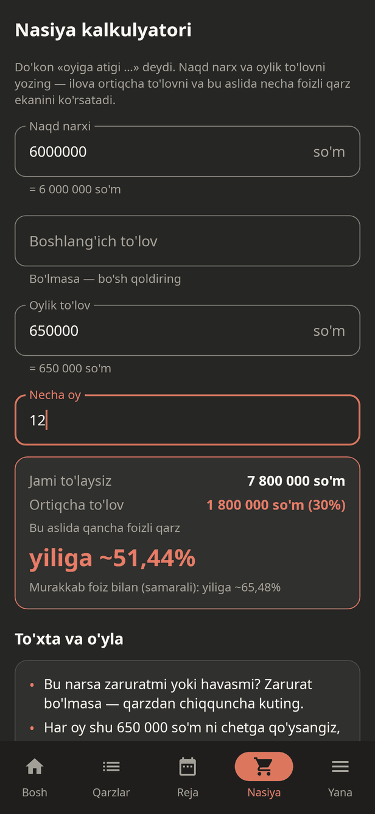
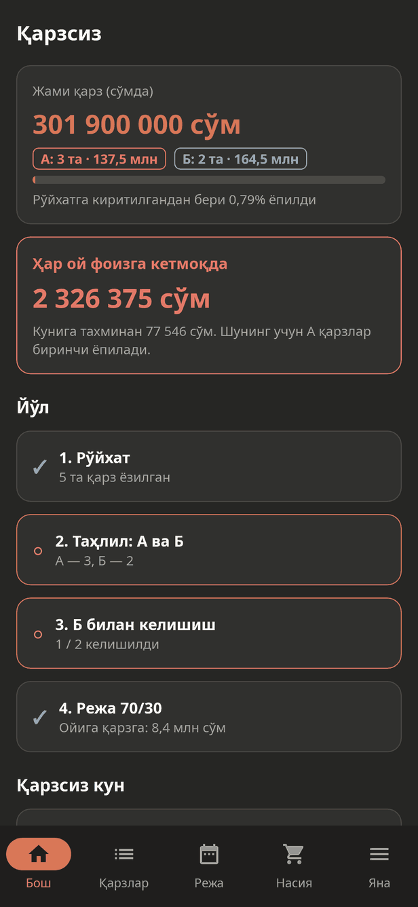
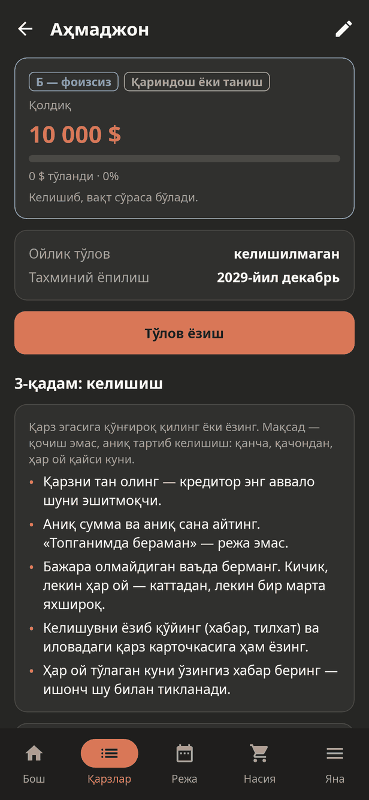
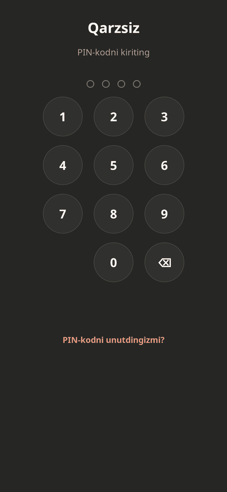

# Qarzsiz

**© 2026 Joʻrabek Mashgʻulatov. Barcha huquqlar himoyalangan** ([LICENSE](LICENSE)).

Kredit, nasiya va tanishlardan olingan qarzlardan **reja bilan chiqish** uchun to'liq
**offlayn** Android ilova. O'zbekiston aholisi uchun, o'zbek tilida — **lotin va kirill** yozuvida.

G'oya «Qarzi borlar buni ko'rishi shart» video matnining ma'nosidan olingan va tanqidiy
qayta ishlangan: to'g'ri g'oyalar olingan, xato yoki xavfli joylari tuzatilgan.
To'liq tahlil: [docs/TAHLIL.md](docs/TAHLIL.md). Ilova mustaqil: matn muallifining ismi,
iboralari va brendi ishlatilmaydi; hech qanday bank, kurs yoki xizmat reklama qilinmaydi.

| Bosh sahifa | Reja 70/30 | Usullar | Nasiya kalkulyatori |
|---|---|---|---|
|  |  |  |  |

## Nima qiladi
1. **Ro'yxat** — har bir qarz: kimdan, turi, valyuta (so'm, $, €, ₽, ₸), qoldiq, foiz (yillik yoki
   oylik), oylik to'lov, to'lov kuni, jarima, muddati o'tgan.
2. **Tahlil: A va B** — foizi yoki jarimasi bor qarz avtomatik **A** («issiq»), foizsizi **B**.
   «Har oy foizga ketmoqda: X so'm, kuniga Y».
3. **Kelishish** — B qarz egasi uchun halol taklif matni (aniq summa, sana, necha oyda yopilishi;
   bosim va bajarib bo'lmaydigan va'dasiz), kelishuv holati. A qarz uchun — bankka muddatni
   uzaytirish arizasi namunasi. Nusxa olish yoki Telegram va boshqa ilovaga yuborish.
4. **Reja 70/30** — daromad × ulush = oylik qarz byudjeti; minimal yashash xarajati tekshiruvi
   (xavfsiz ulush taklifi). **Ikki qavatli to'lov**: hamma qarzning majburiy to'lovi to'xtatmasdan,
   ortgani — strategiya bo'yicha: «Ko'chki» (yuqori foizga), «Qor to'pi» (kichik qarzga),
   «Teng ulush». Shu oy kimga qancha, **qarzsiz kun** sanasi, to'rt usulni taqqoslash.
5. **To'lovlar** — to'lov yozish, tarix, xato to'lovni bekor qilish, yopilgan qarzni nishonlash.
6. **Nasiya kalkulyatori** — naqd narx va oylik to'lovdan ortiqcha to'lov va **yashirin yillik
   foiz** («1000$ lik telefon 2000$» holati), «to'xta va o'yla» savollari.
7. **To'lov kuni eslatmalari** — to'lovdan 1–5 kun oldin va o'sha kuni bildirishnoma (soatni tanlash,
   «Sinab ko'rish»). Internetsiz: `AlarmManager`, qayta yuklanishdan keyin tiklanadi. Shu muddatga to'lov
   yozilgan bo'lsa — eslatma chiqmaydi; qulflangan ekranda tafsilot ko'rinmaydi.
8. **Kun tartibi** — erta turish, harakat, o'qish, daromad uchun bir ish; o'z odatini qo'shish.
9. **Yordam va huquqlar** — stress, bosim va tahdid, to'lay olmaslik, firibgarlik belgilari.
10. **Zaxira nusxa** — foydalanuvchi tanlagan faylga eksport/import (SAF, ruxsatsiz).
11. **Lotin / Кирилл** — yozuv birinchi ekrandayoq va «Yana» bo'limida tanlanadi. Barcha interfeys
    matni (ulashiladigan muzokara matni va ariza ham) tanlangan yozuvda; foydalanuvchi izohlari o'zgarmaydi.

| Кирилл: бош саҳифа | Кирилл: қарз карточкаси |
|---|---|
|  |  |

## Maxfiylik
- `AndroidManifest.xml` da **`INTERNET` ruxsati yo'q** — CI har relizda buni tekshiradi. Ruxsatlar faqat
  ikkita: `POST_NOTIFICATIONS` (eslatmalar, yoqilganda so'raladi) va `RECEIVE_BOOT_COMPLETED` (signalni tiklash).
- Holat AES-256-GCM bilan shifrlanadi, kalit Android Keystore'da. Yozish atomar.
- `FLAG_SECURE` (sozlamada o'chirsa bo'ladi), `allowBackup=false`, bulutli zaxira o'chiq.
- **PIN-kod qulfi** (ixtiyoriy, «Yana → PIN-kod»): 4–6 raqam, faqat PBKDF2-HMAC-SHA256 xeshi saqlanadi
  (tasodifiy tuz, 120 000 takrorlash; Python `hashlib` bilan solishtirilgan). Ilova ishga tushganda va fonda
  tanlangan muddatdan (darhol / 30 s / 1 / 5 daqiqa) uzoq tursa so'raladi. 5-xatodan boshlab kutish
  (30 s → 1 → 5 → 15 daqiqa), hisoblagich qayta ochishda ham saqlanadi. Oson PIN (1234, 0000) rad etiladi.
  PIN yoqilganda bildirishnomada qarz nomlari ko'rinmaydi; zaxira nusxaga PIN yozilmaydi. Unutilsa — tiklab
  bo'lmaydi: ma'lumotni o'chirib, zaxiradan tiklash.

| Qulf ekrani |
|---|
|  |

## Arxitektura
```
qarzsiz/
├── android/
│   ├── core/   # sof Kotlin (JVM): pul, tasnif, rejalovchi, kalkulyator, matnlar — Android'siz test
│   └── app/    # Jetpack Compose UI, shifrlangan saqlash, Robolectric ekran testlari
├── spec/
│   ├── oracle/oracle.py    # mustaqil Python implementatsiya (faqat standart kutubxona)
│   └── test-vectors/*.json # oltin vektorlar: Kotlin yadro ularni aynan takrorlaydi
└── docs/       # TAHLIL.md, CHANGELOG.md, skrinshotlar
```
- Pul — `Long`, kichik birlikda (tiyin/sent); foiz — bazis punkt. `Double` pul uchun yo'q.
- Pul hisoblari faqat `core/` da (`OverviewCalc`, `Planner`, `Installment`); UI tayyor raqam ko'rsatadi.
- Dizayn — Myrep qoidasi: Claude Code dark theme tokenlari, Noto Sans, WCAG AA.
- Kirill yozuvi — `core/Translit.kt` (1995-yilgi alifbo mosligi, oylar va o'zlashgan so'zlar lug'ati,
  valyuta kodlari va brendlar o'zgarmaydi). UI'dagi yagona `Text` (`ui/Components.kt`) matnni
  tanlangan yozuvga o'giradi, shuning uchun matnlar bitta manbada — lotinda — yoziladi.

## Tekshirish va yig'ish
```bash
python3 -I spec/oracle/oracle.py --selftest
python3 -I spec/oracle/oracle.py --check spec/test-vectors
cd android
./gradlew :core:test                 # yadro + oltin vektorlar
./gradlew :app:testDebugUnitTest     # ekran testlari → app/build/outputs/roborazzi/*.png
./gradlew :app:assembleRelease       # app/build/outputs/apk/release/app-release.apk (~1.8 MB)
```
JDK 17+, Android SDK 35. Reliz kaliti: `android/keystore.properties` (`storeFile`, `storePassword`,
`keyAlias`, `keyPassword`; commit qilinmaydi). Bo'lmasa reliz APK debug kaliti bilan imzolanadi —
sinov uchun o'rnatsa bo'ladi, do'konga emas.

Yangi pul funksiyasi qo'shish tartibi: `spec/test-vectors/` ga kirish → `oracle.py --generate` →
Kotlin kod → `:core:test`.

## Keyingi qadamlar
- Sotiladigan buyumlar va «kesilgan xarajatlar»ni qo'shimcha to'lovga ulash.
